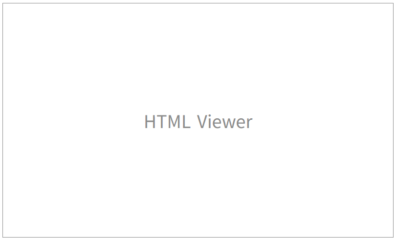
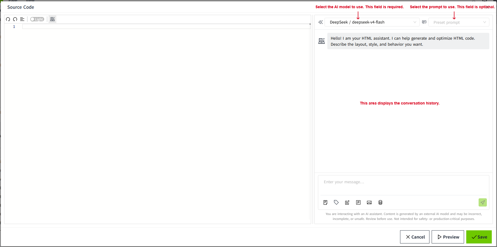
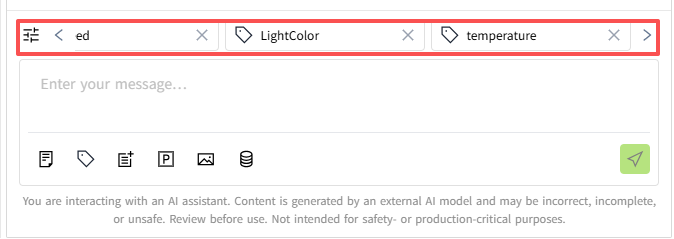
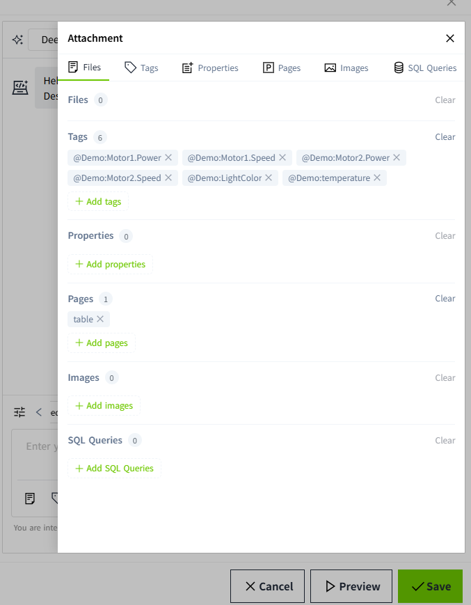
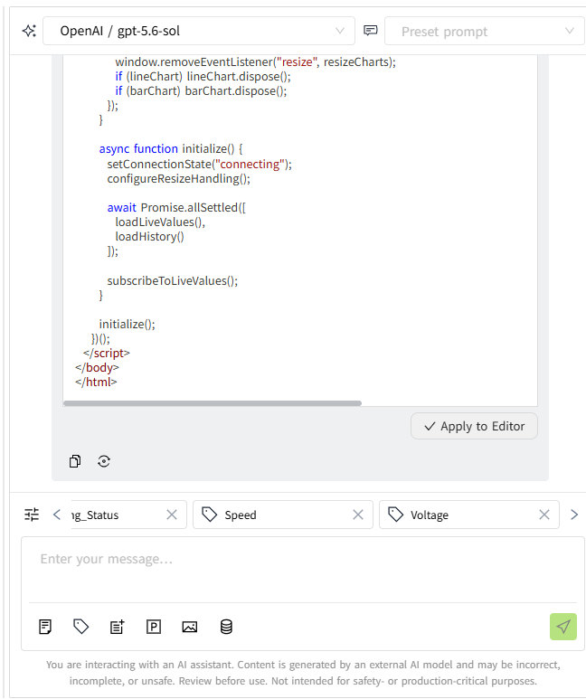
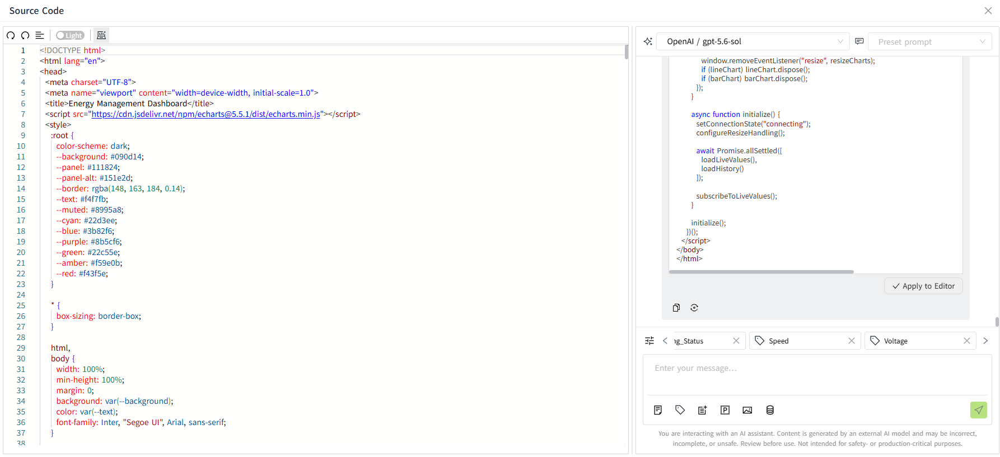
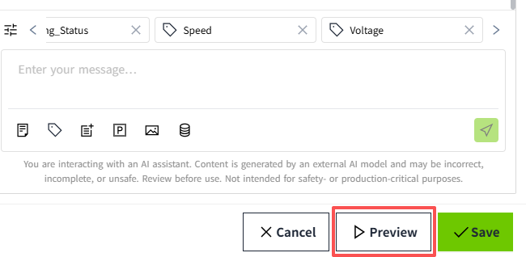
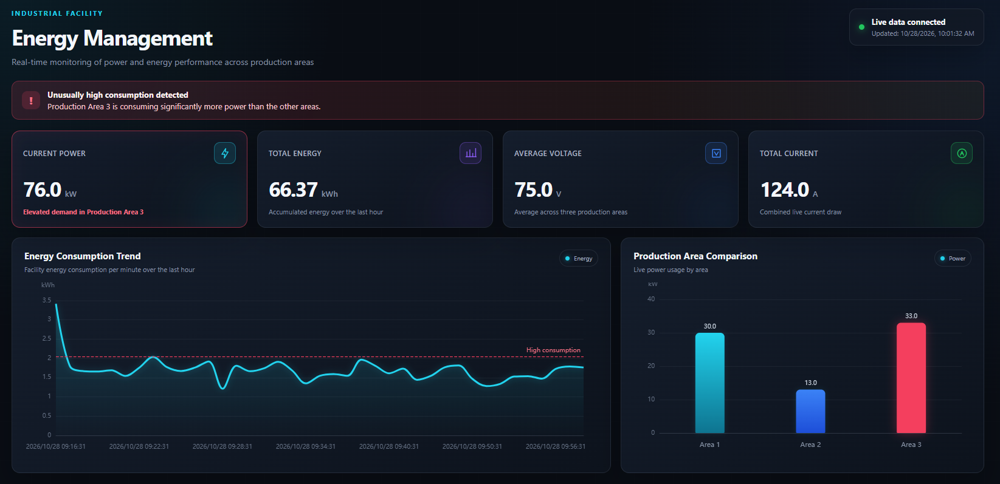
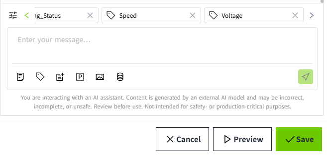

# Html Viewer

The HTML Viewer displays the runtime page generated from HTML code. The HTML code can be generated using the AI Assistant built into the control or obtained from other sources.

**Properties**

| **Name**   | **Description**  |
|------------|---------------|
| Name       | The name of this control.  |
| X          | The distance between the left side of the control and the left side of the canvas.|
| Y          | The distance between the top of the control and the top of the canvas.  |
| W          | The width of the control.  |
| H          | The height of the control. |
| Source Code      |   In the Script Editor, you can use the AI Assistant to generate HTML code for displaying content on a page. The Script Editor is located on the left, and the AI Assistant is displayed on the right.   In the AI Assistant input field, describe the desired page layout and content using natural language. You can also include tags, images, and other relevant information in your description to help generate the page according to your requirements.  |

## **Script Editor**

The Script Editor consists of two areas: the script editing area on the left and the AI Assistant area on the right.

At the bottom of the AI Assistant area, the message input field allows you to enter instructions and add contextual information to help the AI Assistant understand your requirements and generate scripts accordingly.

| **Button**   | **Description**  |
|------------|---------------|
|        |  Upload files or add text and document content to provide additional context for the AI Assistant. |
|        | Select tags from the current system. The selected tags can be referenced in the generated content.|
|         | Select properties of controls on the current page to provide context for script generation.  |
|        |  Select pages that have already been created in the current project to provide context for script generation. |
|          | Select images from the Library of the current project to provide context for script generation. |
|      | Select SQL Queries that have already been created in the current project to provide context for script generation. |
|   | Send the message and the associated context to the AI Assistant to generate a script.  |

The added context items are displayed above the message input field. Use the left and right arrow buttons to browse the items. Click the button on the far left  to view all added context items.

Clicking the button on the far left  opens a panel on the right, displaying all added context items.

After adding the required context, enter a natural language description of the functionality you want to implement in the message input field. Click the Send button to submit your request. The AI Assistant generates the script in the conversation area.

!!! Note

    AI-generated content may be inaccurate, incomplete, or unsafe. Review the generated content carefully before using it.

**Example: Motor Monitoring Dashboard**

**Scenario:** Create a dashboard to monitor three motors, displaying their real-time status, current, power, speed, and voltage. Include power consumption comparisons and trend charts to help users monitor motor performance and energy usage.

**Step 1:** Select tags

- Demo:Motor1.Current
- Demo:Motor1.Power
- Demo:Motor1.Running_Status
- Demo:Motor1.Speed
- Demo:Motor1.Voltage
- Demo:Motor2.Current
- Demo:Motor2.Power
- Demo:Motor2.Running_Status
- Demo:Motor2.Speed
- Demo:Motor2.Voltage
- Demo:Motor3.Current
- Demo:Motor3.Power
- Demo:Motor3.Running_Status
- Demo:Motor3.Speed
- Demo:Motor3.Voltage

**Step 2:** Enter the prompt

Create a dark-themed energy management dashboard for an industrial facility. Show current power consumption, total energy consumption, voltage, and current in KPI cards. Add a line chart for energy consumption over time and a bar chart comparing energy usage across three production areas. Highlight unusually high consumption and use a modern, clean layout.

**Step 3:** Click the "Send" button.

**Step 4:** The AI Assistant automatically generates HTML code based on your prompt.

**Step 5:** Review the generated code. If it meets your requirements, click Apply to Editor to insert the HTML code into the editor on the left.

**Step 6:** Click Preview in the bottom-right corner of the window to preview the generated page.

**Step 7:** If the page does not meet your requirements, refine your prompt and generate new code. Repeat the process until the page meets your requirements, then click Save.

**Step 8:** Save the page to complete the process.

!!! Note

    Previous conversation history is not retained when you close and reopen the editor.