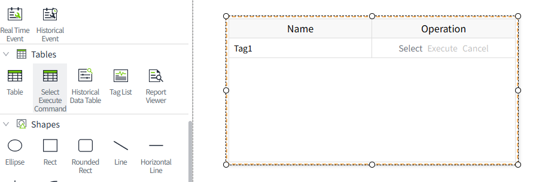
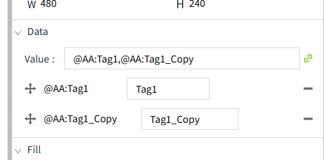
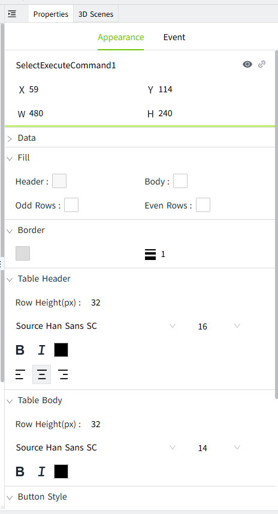
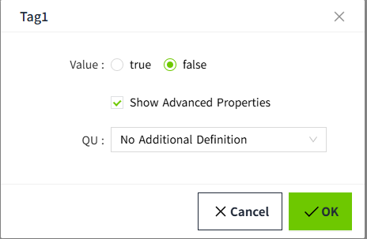
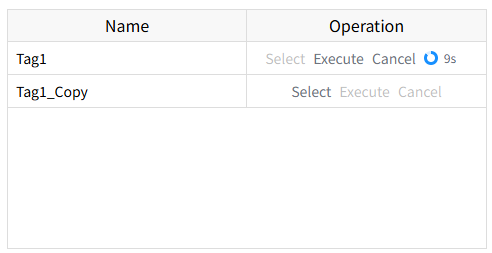

# Select Execute Command

The **Select Execute Command** control sends IEC 60870-5-104 control commands from a 2D runtime page. Each bound tag appears as one row with **Select**, **Execute**, and **Cancel** actions. Operators first select a command value, wait for the station to confirm the selection, and then execute or cancel it.

This control is available under **Tables** in the designer's **Tools** window for on-premise deployments. It is not available in SaaS mode.

## Before You Begin

1. Add and enable an [IEC 104 device](../../../management-platform/devices/iec104/index.md). Confirm that its **Connection Status** is connected. For a TLS connection, complete the [certificate configuration](../../../management-platform/devices/iec104/tls.md) first.
2. Create an I/O tag of type **Bool**, **Integer**, or **Double** and bind it to the IEC 104 device.
3. In the tag's data source binding, configure the **Common Address**, **Information Object Address**, and an **ASDU Type** in the control direction (`C_*`) that matches the remote station's point definition.
4. Confirm that the remote station supports the select-before-operate sequence for that point.

A monitoring type such as `M_SP_NA_1` or `M_ME_NC_1` is not a control command. Use a separate monitoring tag when you need to display the actual equipment state or measured value.

## Add and Configure the Control

1. Open a 2D page in the designer.
2. In **Tools** -> **Tables**, drag **Select Execute Command** onto the canvas.
3. Select the control and open **Data** in the **Properties** window.
4. Use the tag selector to add one or more IEC 104 command tags. Select the tags themselves rather than an expression.
5. Edit each tag's display name to describe the operation, for example **Feeder 1 Command**. Display names must be unique within the control.
6. Drag entries to change their row order, or use the remove button to delete an entry from the control.
7. Configure the table and button appearance as needed, then save the page.
8. Open **Preview** or the runtime page to use the command actions.

Removing a row from the control does not delete its tag. The control uses the device and point addresses already configured in the tag binding; those addresses are not entered again in the control.

!!! note
    The command actions are built in. You do not need to add a mouse-event script to send Select, Execute, or Cancel.

## Properties

| Property | Description |
| --- | --- |
| Name | The control's name. This is separate from the display names of its bound tags. |
| X / Y | Position of the control on the canvas. |
| W / H | Width and height of the control. The control cannot be rotated. |
| Data | Add or remove bound tags, edit their display names, and reorder the rows. |
| Fill | Set the header, body, odd-row, and even-row background colors. |
| Border | Set the border color and thickness. |
| Table Header | Set the header row height, font, size, bold, italic, font color, and horizontal alignment. |
| Table Body | Set the body row height, font, size, bold, italic, and font color. |
| Button Style | Configure **Select Button**, **Execute Button**, and **Cancel Button** separately. Each supports bold, italic, and font color. |

The table has two fixed columns:

| Column | Content |
| --- | --- |
| Name | The configured display name, or the tag path if no display name is set. Hover over the name to see the tag path. |
| Operation | Select, Execute, and Cancel actions. A countdown indicator appears after a successful selection. |

The control does not have a separate current-value or command-result column.

## Supported Command Values

The available ASDU types depend on the tag's data type. The following control types can be selected in the IEC 104 tag binding:

| Command | ASDU types | Tag type | Value |
| --- | --- | --- | --- |
| Single command | `45 C_SC_NA_1`, `58 C_SC_TA_1` | Bool | `false` = OFF; `true` = ON. |
| Double command | `46 C_DC_NA_1`, `59 C_DC_TA_1` | Bool or Integer | For Bool: `false` = OFF; `true` = ON. For Integer: `1` = OFF; `2` = ON. |
| Normalized set-point command | `48 C_SE_NA_1`, `61 C_SE_TA_1` | Double | A value from `-1` to `1`, inclusive. |
| Scaled set-point command | `49 C_SE_NB_1`, `62 C_SE_TB_1` | Integer or Double | A whole number from `-32768` to `32767`. |
| Short floating-point set-point command | `50 C_SE_NC_1`, `63 C_SE_TC_1` | Double | A finite value representable as a 32-bit floating-point number. |

The Select dialog uses radio buttons for Bool tags, a numeric input for Integer tags, and a value input for Double tags. Double values must be valid finite numbers. Protocol-specific range and state validation is performed when the command is submitted.

### QU for Bool Tags

For a Bool tag, enable **Show Advanced Properties** in the Select dialog to display **QU** (Qualifier of Command).

| QU | Option |
| --- | --- |
| 0 | No Additional Definition |
| 1 | Short Pulse Duration |
| 2 | Long Pulse Duration |
| 3 | Persistent Output |

The default is **0** when advanced properties are not enabled. The selected value and QU are reused when you click Execute. Choose a QU option supported by the remote station; pulse behavior is defined by that station. The QU selector is not shown for Integer or Double tags.

## Run a Command

### Select

1. Find the required tag row and click **Select**.
2. The control checks the tag's IEC 104 binding and obtains its data type and the device's **Command ACK Timeout (ms)**.
3. In the dialog, enter or select the command value. The current tag value is used as the initial value where available.
4. For a Bool tag, configure QU if required.
5. Click **OK** to send the Select command and wait for confirmation.

While the selection is being prepared, Execute and Cancel remain disabled. Only a confirmed selection enables those actions. If selection fails, review the error message and correct the value, binding, or connection before retrying.

Clicking **Cancel** in the value dialog before submitting closes the dialog without sending a command. This is different from the row's Cancel action after a confirmed selection.

### Execute

After Select succeeds, click **Execute** before the countdown ends. The control sends the same value and QU used for the selection; it does not prompt for another value.

During execution, the row's actions are disabled. After the request finishes, the row returns to its initial state. To issue another command, start with Select again. If an error is reported, check the device response and actual equipment state.

### Cancel

After Select succeeds, click the row's **Cancel** action to send a deactivation command for that selection. After the request finishes, the row returns to its initial state.

To change a selected command value, cancel the selection and select again with the new value. Cancel withdraws a pending selection; it does not undo an operation that has already been executed.

### Button Availability and Timeout

| Row state | Select | Execute | Cancel |
| --- | --- | --- | --- |
| Initial state | Enabled | Disabled | Disabled |
| Preparing or waiting for Select confirmation | Disabled | Disabled | Disabled |
| Selection confirmed, before countdown expiry | Disabled | Enabled | Enabled |
| Waiting for an Execute response | Disabled | Disabled | Disabled |
| After an Execute or Cancel request finishes, or after countdown expiry | Enabled | Disabled | Disabled |

The device's **Command ACK Timeout (ms)** determines how long VC Hub waits for a command response. It also supplies the countdown duration after a confirmed selection. The default device setting is **10000 ms** (10 seconds). Change this setting on **Devices** -> **IEC 104**, rather than in the control's appearance properties.

When the countdown reaches zero, the control clears the selected value and disables Execute and Cancel. A new selection is required. Each row maintains its own selection state.

!!! note
    Countdown expiry only resets the control's local selection state; it does not send a Cancel command to the station. Refreshing or leaving the page also does not send Cancel. To withdraw a confirmed selection explicitly, use the row's Cancel action before the countdown ends. The station's own selection lifetime still applies.

## Example: Send an ON Command

The following values illustrate a single-command point. Replace the addresses and ASDU type with those defined by your station.

| Setting | Example |
| --- | --- |
| Device | An enabled, connected IEC 104 device |
| Tag name / type | `Feeder1Command` / Bool |
| Common Address | `1` |
| ASDU Type | `45 C_SC_NA_1` |
| Information Object Address | `1001` |
| Command ACK Timeout | `10000` ms |
| Control row display name | Feeder 1 Command |

1. Add the control and bind `Feeder1Command` through **Data**.
2. Open the runtime page and click **Select** in the **Feeder 1 Command** row.
3. Choose `true`. Leave QU at its default unless the station requires another option.
4. Click **OK** and wait for the selection to be confirmed.
5. Click **Execute** while the countdown is visible. To withdraw the selection instead, click the row's **Cancel** action.
6. Verify the resulting equipment state using the corresponding monitoring tag.

A positive command confirmation is a protocol response. It does not replace equipment feedback or prove that the physical operation has completed.

## Troubleshooting

| Symptom | What to check |
| --- | --- |
| The control is not shown in Tools | Select Execute Command is available only for on-premise deployments. Look under **Tables**. |
| No rows appear | Add tags through the control's **Data** property. |
| "This tag does not support this operation." | Check that the tag exists and is bound to an IEC 104 device. Use a Bool, Integer, or Double command tag rather than an expression. |
| "Unsupported write type" | Check the tag's ASDU type. Monitoring types (`M_*`) cannot be used to send control commands. |
| "Invalid command value" or an out-of-range error | Check the command's value range and the tag's configured limits. For an Integer double command, use `1` or `2`, not `0` or `1`. |
| The device returns a negative confirmation | Check the station's command support, point addresses, value, QU, and operating conditions. |
| A confirmation times out | Check device connection status, network connectivity, station responses, and **Command ACK Timeout (ms)**. A timeout alone does not establish the equipment's final state. |
| Execute and Cancel remain disabled after Select | The station has not confirmed an active selection, or the countdown has expired. Check the response and select again when appropriate. |
| The row returns to its initial state, but equipment feedback has not changed | Check the separate monitoring tag and the station's actual state. The control does not display or synthesize equipment feedback. |
