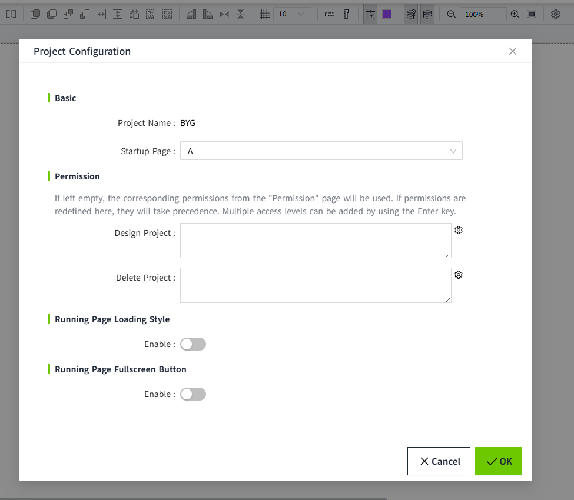
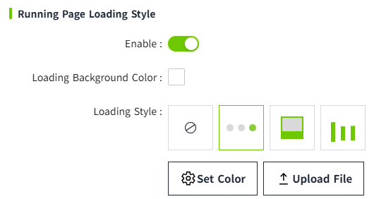
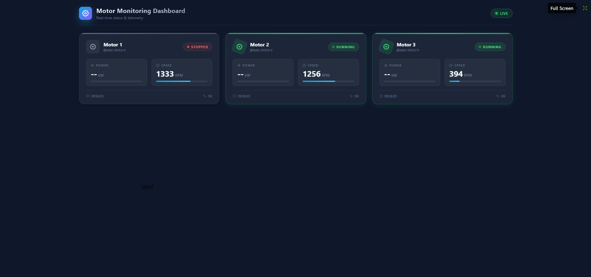

# Project Properties

You can set  configurations for the current project in the 2D Editor. For example, startup page, loading effect of running page, etc.

Click the Settings button on the menu bar to set properties.

| **Name**                   | **Description**  |
|----------------------------|---------------------------------------|
| Project Name               | Displays the name of the current project.  |
| Startup Page               | Set the startup page of the project, the first page created is selected by default.  After setting, this page is automatically displayed when you click the run button of the project in the project list.   |
| Login Page                 | When the Identity Provider is set to **Local** type, you can customize a page to serve as the login page during runtime.   |
| Design Project             | Configure design permissions for this project (i.e., permissions for editing and saving in the editor).   - By default, this field is empty. When empty, the system uses the design project permissions defined in Security > Permission.  - Permissions configured here will replace those set in Security > Permission.  -  If the design permissions' access level path is within the user's access level path, the user will have the right to design the project.   |
| Delete Project             | Configure delete permissions for this project.   - By default, this field is empty. When empty, the system uses the delete project permissions defined in Security > Permission.  - Permissions configured here will replace those set in Security > Permission.  -  If the delete permissions' access level path is within the user's access level path, the user will have the right to delete the project.    |
| Running Page Loading Style | Used to set the running page and the loading effect before the page content is fully loaded. If not enabled, the system default loading effect will be used; if enabled, the user is allowed to customize the loading background color and loading style of the running page.        |
| Loading Background Color   | This configuration item is only displayed after turning on "Running Page Loading Style". Set the background color of the running page when loading.    |
| Loading Style              | This configuration item is only displayed after turning on "Running Page Loading Style". Set the loading animation when the running page is loaded.  Built-in styles support changing colors. After selecting the style, click the "Set Color" button to modify the color.  It also supports users to upload pictures by themselves. Images uploaded by users themselves do not support color modification.    |
| Enable Fullscreen Button  | The full-screen button for the Runtime Page can be enabled or disabled. When enabled, the full-screen button shall appear when the mouse pointer is moved to any of the four corners of the Runtime Page. Clicking the button shall display the Runtime Page in full-screen mode.  |
| Fullscreen Button Color  | Sets the color of the full-screen button. |
| Exit Fullscreen Button Color  | Sets the color of the exit full-screen button.  |

**Notes:** 

1. If the network connection is good, the loading effect of the runtime page will flash by almost instantly. 

## Run page loading styles

Sets the loading effect for the running page when navigating from Page1 to Page 2.

1. Create two pages, Page1 and Page2.
2. Place a button on Page1 that when clicked navigation to Page2.

    | **Property**               | **Value**    |
    |----------------------------|-----------------------------------------------------|
    | Running Page Loading Style | Enable  |
    | Loading Background Color   | 02023b      |
    | Loading Style              | |

    Run the page and click the "Open Page 2" button on page 1. The page is loading. When the loading is completed, Page 2 is displayed.

    

## Runtime Page Full Screen

1. Enable the full-screen function for the Runtime Page.
2. On the Runtime Page, when the mouse pointer is moved to any corner, the Full Screen button shall be displayed. Clicking the button shall switch the Runtime Page to full-screen mode.
3. In full-screen mode, when the mouse pointer is moved to any corner, the Exit Full Screen button shall be displayed. Clicking the button shall exit full-screen mode.

    

