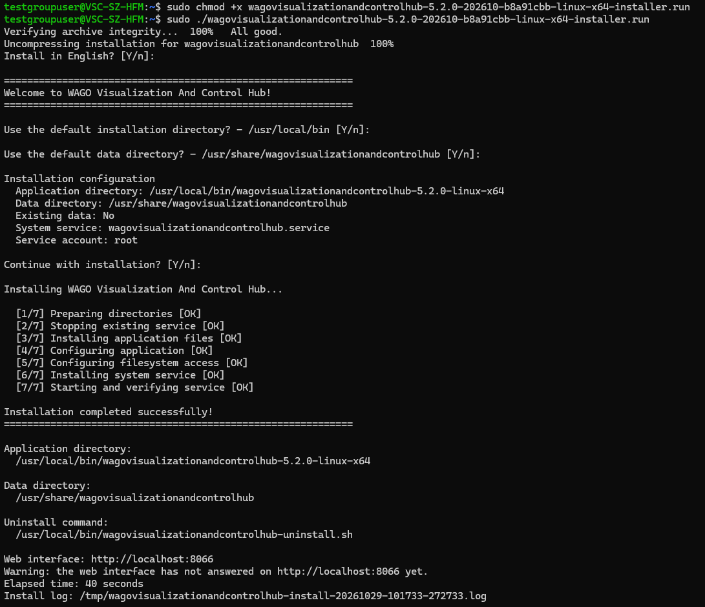
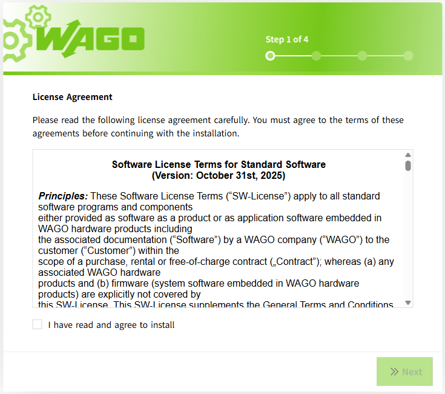
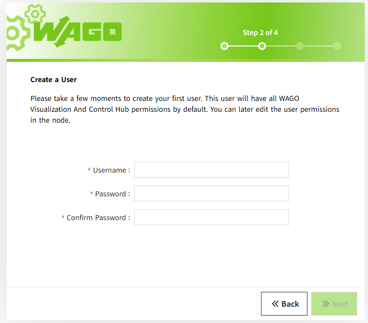
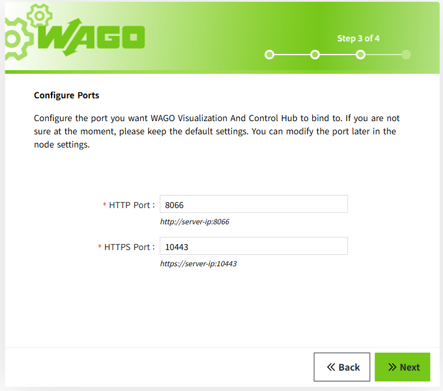
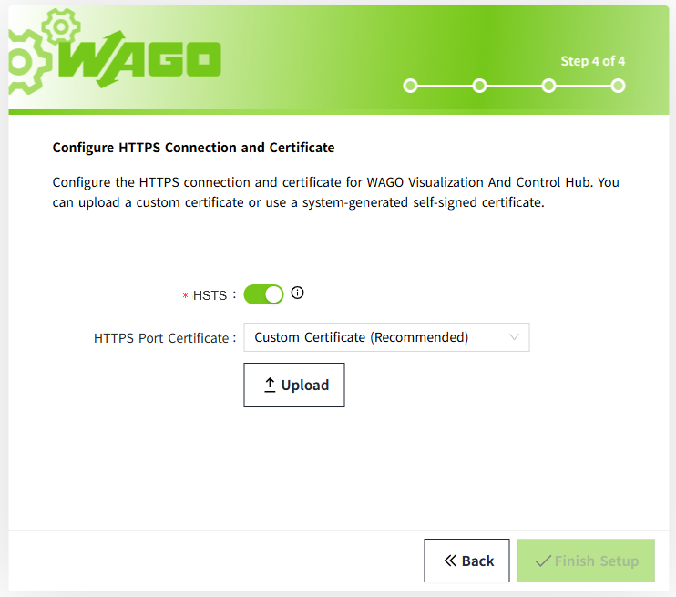
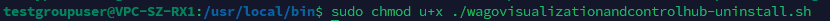
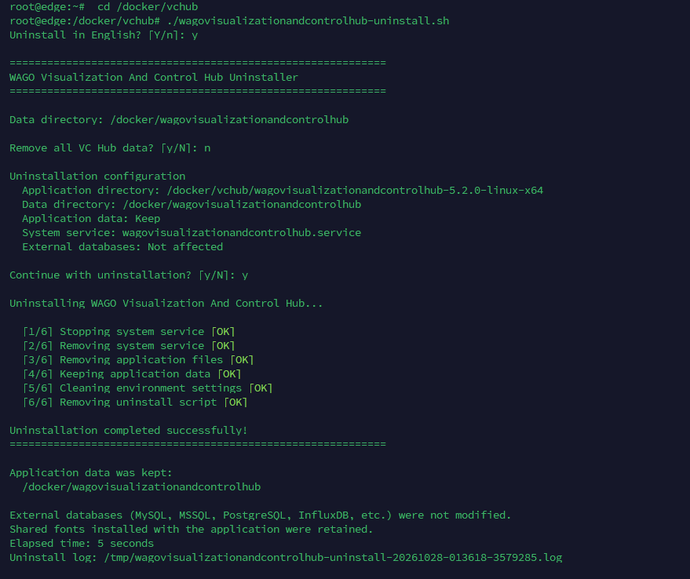

# Linux Environment 

VC Hub provides a self-extracting installation package for 64-bit Linux. The package name includes the VC Hub version and may also include the build date and build number, for example `wagovisualizationandcontrolhub-<version>-<build-date>-<build-number>-linux-x64-installer.run`.

## **Installation Steps** 

1. **Prepare the installation package.** 
    Copy the installation package to the Linux server and open a terminal in the directory containing it.

2. **Run the installer.** 
    Grant execute permission to the package and run it with `sudo`. Replace `<installer-file>.run` below with the actual package file name.

    ```bash
    chmod u+x "<installer-file>.run"
    sudo "./<installer-file>.run"
    ```

    The package verifies its archive integrity and extracts the installation files before starting the interactive installer.

3. **Select the installation language.** 
    Select the installation language at the `Install in English? [Y/n]:` prompt. Enter `y` for English or `n` for Chinese.

    For yes/no prompts, the uppercase letter is the default when you press **Enter**: `[Y/n]` defaults to Yes, and `[y/N]` defaults to No.

4. **Choose the installation directory.**

    - On a first installation, the installer offers `/usr/local/bin` as the default parent directory.
    - If a previous installation directory was recorded, the installer offers that directory instead.
    - Enter `y` to accept the offered directory, or `n` and then an absolute path, such as `/opt/vchub`, to use another directory. Missing directories are created automatically.

    The selected directory is the **parent** directory. The installer creates a versioned application subdirectory inside it. For example, selecting `/opt/vchub` installs the application to `/opt/vchub/wagovisualizationandcontrolhub-<version>-linux-x64`. Do not add the versioned subdirectory to the path you enter.

5. **Choose the data directory.**

    - If a previous data directory was recorded, the installer first asks whether to reuse it. Accept it to continue using that data location.
    - Otherwise, or if you decline to reuse it, accept the default `/usr/share/wagovisualizationandcontrolhub`, or enter `n` and then a custom absolute path, such as `/var/lib/vchub`.

    Use a dedicated data directory separate from the application directory. A new data location should be empty or already contain VC Hub data. Selecting a different directory does not automatically move data from the previous location.

6. **Review and confirm the installation configuration.**
    Review the installation configuration, including the full application path, data path, whether existing data is reused, and system service name.

    If the application directory is not empty, the installer asks for confirmation before displaying the summary. Continuing can overwrite files and change their ownership and permissions. Confirm only if this directory is dedicated to VC Hub.

    At `Continue with installation? [Y/n]:`, enter `y` or press **Enter** to proceed. Enter `n` to cancel.

7. **Complete the installation.**
    Wait while the installer prepares the directories, stops any existing service, installs and configures the application, configures file access, registers the system service, and starts and verifies the service.

    The current standard installer displays seven progress steps with `[OK]` or `[FAILED]` status indicators. A spinner is also displayed when the terminal supports it.

    When `Installation completed successfully!` appears, note the displayed application directory, data directory, uninstall command and installation log path.

    The following example shows the complete installation process:

    

8. **Access to VC Hub.**
    Open `http://localhost:8066` in a browser on the Linux server. To access VC Hub from another computer, use `http://<server-address>:8066` and ensure the server allows access to that port. Complete the configuration wizard described in **Configuration** below when it is displayed.

**Notes:** 

1. VC Hub is managed by `systemd`. Ensure that `systemd` is running and that the account used for installation has `sudo` privileges. The installer starts the service and enables it to start automatically at system boot.
2. If a step fails, the installer displays the failed step, the installation log path and the last log entries. The log is normally stored under `/tmp` with a name such as `wagovisualizationandcontrolhub-install-<timestamp>-<process-id>.log`. Use the exact path printed by the installer when investigating a failure.
3. If the installer reports that the web interface has not answered yet, or the page cannot be opened, check the service status and recent service messages:

    ```bash
    sudo systemctl status wagovisualizationandcontrolhub.service --no-pager
    sudo journalctl -u wagovisualizationandcontrolhub.service -n 100 --no-pager
    ```

## **How to Fix libice6 / libsm6 Installation Failures**

If you see the message **"Failed to install libice6/libsm6. Please try installing it yourself."** during setup, you can install these packages manually by following the steps below:

1. Open a terminal.

2. Update the package list:
   ```
   sudo apt update
   ``` 
3. Install the required libraries:
   ``` 
   sudo apt install libice6 libsm6
   ``` 
   If the installation succeeds, no further action is required.<br>
   If you encounter an error such as **"Unmet dependencies"** or a prompt suggesting to  **try 'apt --fix-broken install'"**, this indicates broken package dependencies on your system.<br>
   Run the following command to resolve them:<br>
   ```
   sudo apt --fix-broken install
   ```
   This command attempts to repair inconsistent package states by installing missing dependencies or completing interrupted installations.
4. After the fix completes successfully, retry installing the libraries:
   ```
   sudo apt install libice6 libsm6
   ```
## **Configuration**

1. Read and agree the license agreement
   
2. Create an administrator user. Remember this username and password, as you will use them to log in for the first time. 
   
3. Port configuration, configure HTTP, HTTPS ports, and remember the access port. 
   
4. Configure Https connection and certificate.
   
5. After completing the above steps, wait for the program to load, and then you can log in to the default workspace with the administrator user created in step 2.

**Note**: If you perform an upgrade installation, a new empty workspace will be created by default. To return to the original workspace, you need to log in to the new workspace first and then manually open the original workspace from the workspace list. 


<!--
Temporarily hidden: non-privileged service accounts are not enabled in the current standard release.

## **Service Security**

The installer automatically creates or reuses the non-login `vchub` system account and configures the VC Hub systemd service to run under that account. It also grants the service only the application and data directory permissions required at runtime.

Do not assign a password to `vchub`, add it to the `sudo` group, configure passwordless sudo, or change the service to run as root.

Linux ports below 1024 require additional operating-system permission. Use a port of 1024 or higher whenever possible. If a low port is required, follow the capability-based procedure in [VC Hub Service Account and File Permissions](setup-service-running-user.md#using-ports-below-1024-on-linux); do not run VC Hub as root.

-->

## **Uninstallation Steps**

1. Go to the parent directory of the installation directory.
2. Grant the file owner the permission to execute the file "`wagovisualizationandcontrolhub-uninstall.sh`"
    
3. Run the script "`wagovisualizationandcontrolhub-uninstall.sh`".
   
4. Choose whether to delete all data, including the data in the data directory.
5. Perform the uninstallation operation.

**Notes:**  

The uninstallation script includes operations such as deleting files, so ensure you have sufficient permissions.
