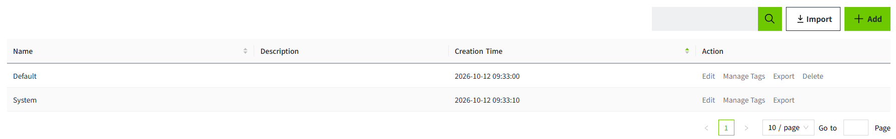
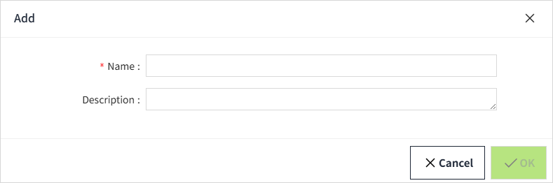
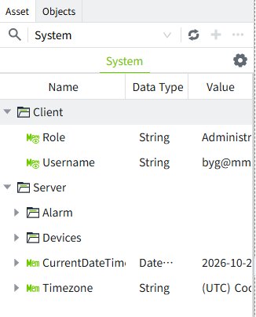
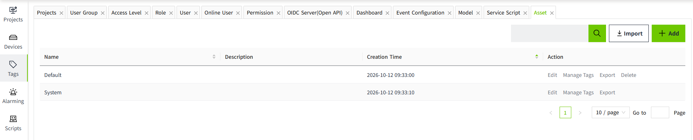
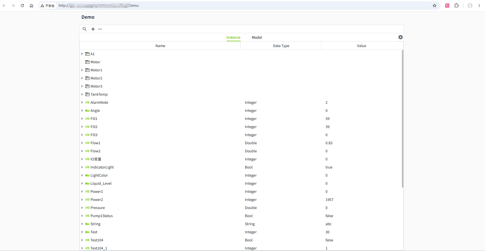
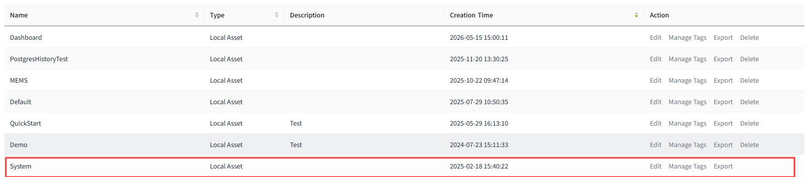

# Asset

 There can be any number of assets in VC Hub, and the user can create tags to be maintained in any asset. Assets can be viewed as containers for tags, and the tags in each asset are isolated from each other, and the tags are dependent on the asset for their existence in the system. 

 All tags are available in the Asset and have real-time values. If historical storage is enabled for a tag, its historical data will be stored automatically and can be viewed later using a History control.

 The system provides two built-in Assets: Default and System.

 

## **Add Asset**

 Click the Add button in the upper-right corner of the list to add a new Asset.

**Configuration items**

| **Configuration** | **Description**   |
|-------------------|--------------|
| Name              | The name of the asset, the name cannot be repeated, required.  |
| Description       | Description of the asset, optional. |

#### **System Asset**

 It is used to view system information, such as user information, alarm information, and device connection status.

## **How to use**

 Click "**Tags** "->"**Asset** "menu to enter the asset management page.

#### **Query**

 After  entering the asset m anagement page, users can view all the assets under the current workspace, which are sorted in reverse chronological order by default,and users can customize the sorting according to their needs.

 Users can do fuzzy query on the asset name through the input box in the upper right corner.

#### **Add**

 Users can add new assets by clicking the "Add" button in the upper right corner and filling in the asset information.

#### **Edit**

 Users can modify the asset information by clicking the "Edit" button on the right side of any asset in the asset list. Once an asset is created, its asset type cannot be modified.

#### **Manage Tags**

This function is used to manage all tags under the Asset.

Clicking the button will open a new browser window displaying the Asset Tree. The Asset Tree  provides the same functionality as the Asset window in the 2D Designer.

#### **Delete**

 Users can click the "Delete" button on the right side of any asset in the asset list to delete the selected asset. After clicking the button, a prompt box will pop up, and users can click OK to delete the asset. Note that when the asset is deleted, all models, instances and tags under the asset will be deleted together.

 The **System** Asset cannot be deleted.

 

#### **Export**

 Users can click the "Export" button on the right side of any asset in the asset list to export the asset configuration and all models, instances and tagsunder the selected asset to a Json file.

 When exporting remote assets, only the asset configuration information will be exported.

 Note that it is not recommended to modify the Json file if you don't understand its contents.

#### **Import**

 With  the "Import" button on the top right corner of the page, users can import the Json file into the system again. If there is a renamed asset in the current system, users will be prompted to change the name.

  

