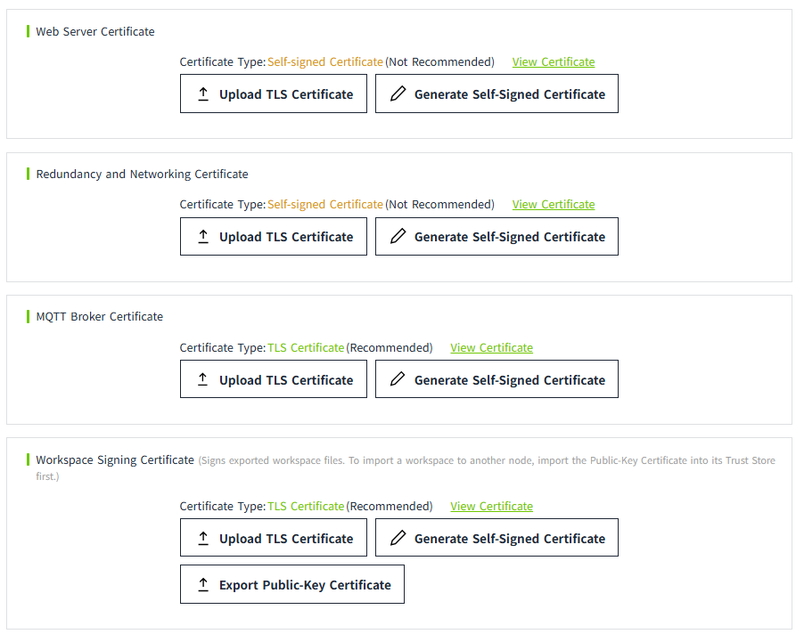
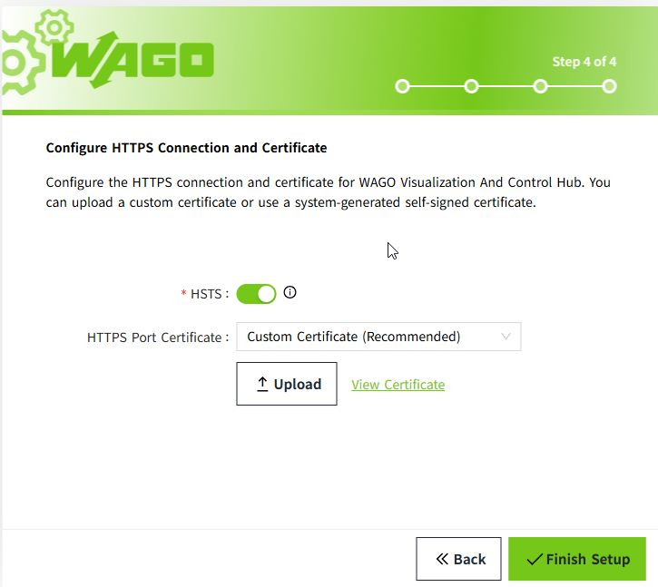
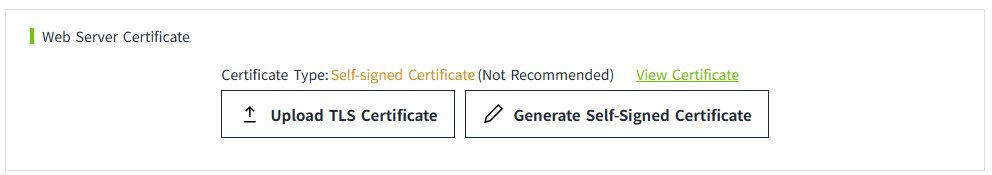
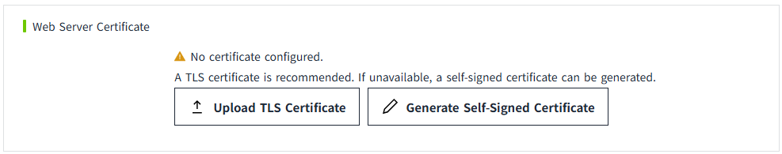
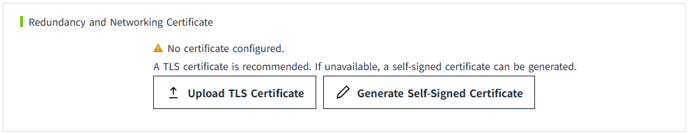
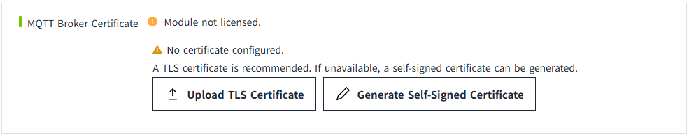
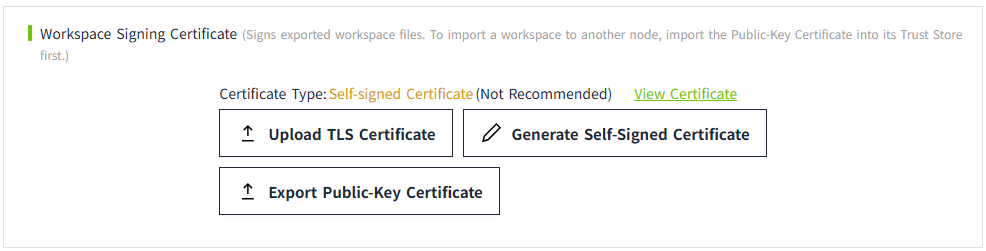

# Certificate Management

Used to centrally manage certificates. Each type of certificate is stored independently. Includes:

- **Web Server Certificate:** Used to configure secure communication between Web clients (such as browsers) and the VC Hub server.
- **Redundancy / Networking Certificate:** Used to configure secure communication between multiple VC Hub nodes in redundancy or networking mode.
- **MQTT Broker Certificate:** Used to configure secure communication between MQTT clients (such as field devices or VC Hub clients) and the MQTT Broker.
- **Workspace Signing Certificate:** Used to sign exported workspace files. To import a workspace to another node, first import the corresponding public-key certificate into that node's Trust Store.

## Web Server Certificate

VC Hub allows users to view and manage the TLS certificate used for secure web server communication. By default, the certificate information configured during the initial setup is displayed on the Certificate Management page.

If HSTS is enabled, a certificate must be configured. After logging in, the configured certificate information is displayed under Web Server Certificate on the Certificate Management page, as shown below.

If HSTS is disabled, VC Hub can operate without a user-configured certificate. The Web Server Certificate section on the Certificate Management page displays the current certificate status, as shown below.

Click "View Certificate" to view the certificate details. Users can also upload a new TLS certificate or generate a new self-signed certificate. The new certificate takes effect immediately after configuration.

## Redundancy and Networking Certificate

By default, no certificate is configured. Users can upload a TLS certificate or generate a new self-signed certificate. The new certificate takes effect immediately after configuration.

Click "View Certificate" to view the certificate details. 

!!! Warning
    Before configuring redundancy or networking, you must configure a certificate first.

## MQTT Broker Certificate

By default, no certificate is configured. Users can upload a TLS certificate or generate a new self-signed certificate. The new certificate takes effect immediately after configuration.

Click "View Certificate" to view the certificate details. 

!!! Warning
     Before enabling TLS for the MQTT Broker, you must first configure the certificate here.

## Workspace Signing Certificate

By default, a self-signed certificate will be generated. Users can upload a TLS certificate or generate a new self-signed certificate. The new certificate takes effect immediately after configuration.

!!! Note
    When importing a workspace into the same node, if certificate verification is enabled, ensure that the certificate used to sign the workspace matches the workspace signing certificate configured on the current node. Otherwise, the import will fail. 
    To import a workspace into another node, first import the public-key certificate used to sign the workspace into that node's Trust Store.
    

