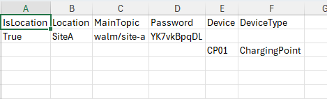
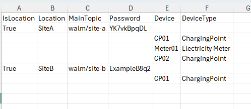
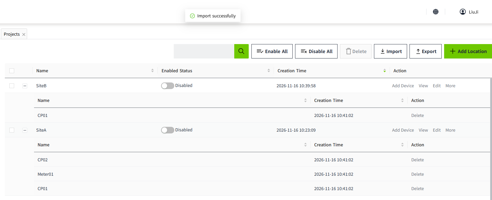
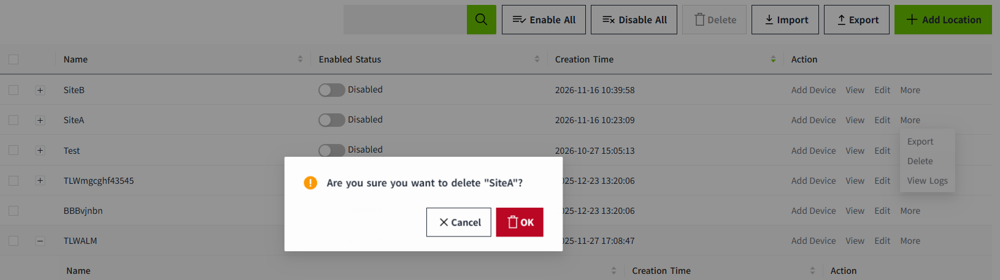

# Batch Operation of WALM Devices

Use Excel export and import to add or update multiple WALM locations and their devices. First add a demonstration location with an electricity meter or charging point, then export it to obtain a template.

## Exporting Locations and Devices

Click **Export** above the WALM list to export all locations, or select **More → Export** in a location's row to export only that location. The `.xlsx` file contains the location configuration and the devices under each location.

Keep these columns in the exported order:

| Column | Location row | Device row |
|---|---|---|
| `IsLocation` | Set to `True`. | Leave empty, as in the export, or set to `False`. |
| `Location` | Required location name. Used to match an existing location or create a new one. | Leave empty; the device belongs to the preceding location row. |
| `MainTopic` | MQTT topic prefix. Leave empty to use the location name. | Leave empty. |
| `Password` | Required MQTT connection password. Export includes the current password. | Leave empty. |
| `Device` | Leave empty. | Required device name, matching the MQTT topic's device segment. |
| `DeviceType` | Leave empty. | `ElectricityMeter` or `ChargingPoint`. |

The file contains configuration only. It does not export live measurements, I/O tag bindings, or a separate copy of each device's predefined tags. Enabled status is not included; every imported location is disabled after import.

## Preparing the Import File

1. Open the exported workbook in Excel. Keep the column headers in the first row and preserve their names and order.
2. Start with a location row whose `IsLocation` value is `True`.
3. Place that location's device rows immediately below it. Start another location row before entering devices for a different location.
4. Use unique location names in the file. Device names must be unique within each location. Names must follow the normal naming rules and be no longer than 100 characters.
5. Enter a password for every location row. An empty Password cell does not retain or generate a password; it causes validation to fail. Format password cells as Text to preserve their exact content.
6. Set each device's `DeviceType` to `ElectricityMeter` or `ChargingPoint`, without spaces. The **Device Info** category belongs to the location and does not need a device row.
7. Save the workbook as `.xlsx`. Keep the import data on the first worksheet.

For example:

| IsLocation | Location | MainTopic | Password | Device | DeviceType |
|---|---|---|---|---|---|
| True | SiteA | walm/site-a | ExampleA7p9 | | |
| | | | | Meter01 | ElectricityMeter |
| | | | | CP01 | ChargingPoint |
| | | | | CP02 | ChargingPoint |
| True | SiteB | walm/site-b | ExampleB8q2 | | |
| | | | | CP01 | ChargingPoint |

The passwords above are examples. Replace them with the passwords intended for your WALM applications. A location can have no device rows if only its location-level information is required.

## Importing Locations and Devices

1. Click **Import** above the WALM list and select the `.xlsx` file.
2. If validation fails, correct the reported rows and import the file again.
3. After the import succeeds, review the imported locations and devices. All locations added or updated by the import are disabled.
4. Enable the locations you want to use. If a password or Main Topic changed, update the corresponding WALM application's settings before reconnecting.

## Batch Modification

Export the configuration, edit the required rows, and import the workbook again. Locations are matched by **Location** name:

| Imported content | Result |
|---|---|
| Location name already exists | Replace its Main Topic and password, replace its entire device list with the device rows in the file, and disable the location. |
| Location name does not exist | Create a new disabled location with the supplied Main Topic, password, and devices. |
| Existing location is absent from the file | Leave that location and its devices unchanged. |
| Existing device is omitted under an imported location | Remove that device from the location. |

!!! warning "Import replaces the device list of each included location"
    Keep every device that should remain under an imported location in the workbook, including devices whose settings are unchanged. Importing only the location row removes all its existing devices. After import, check I/O bindings for devices that were removed, renamed, or assigned a different type.

Changing a location name in Excel creates another location; it does not rename or remove the original location. To retain an existing password, keep its exported value in the location's Password cell. Use distinct Main Topic prefixes for different locations.

## Batch Deletion

1. Disable the locations you want to delete.
2. Select their checkboxes on the current page.
3. Click **Delete** above the list and confirm the deletion.

Enabled locations cannot be selected for deletion. Selection is limited to the current page. Deleting a location also removes all its devices; review the I/O tags bound to those sources.

To enable or disable every configured location, use **Enable All** or **Disable All**. These actions apply to all locations, not just the selected rows or current page.

Return to [WALM](index.md) for connection settings, message formats, and I/O tag binding.
