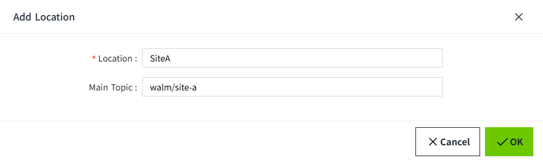
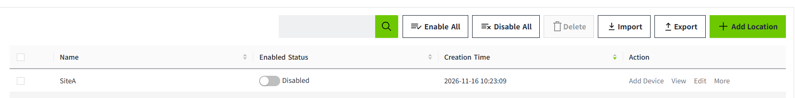
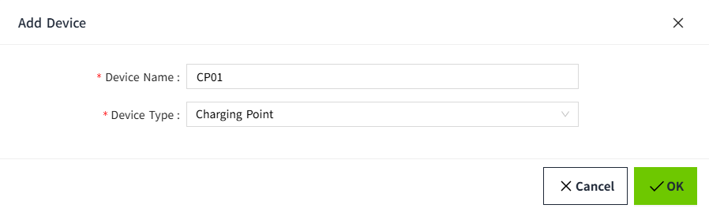
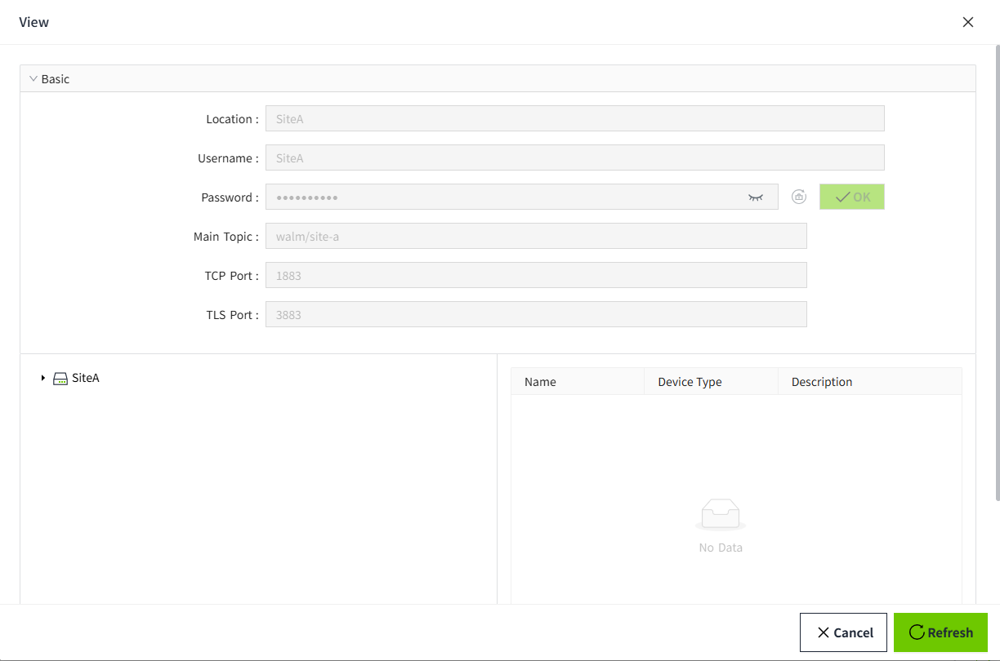
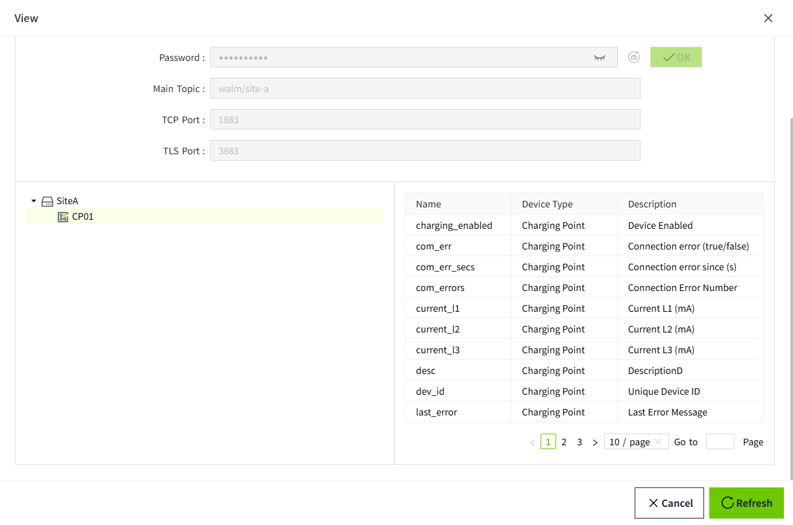
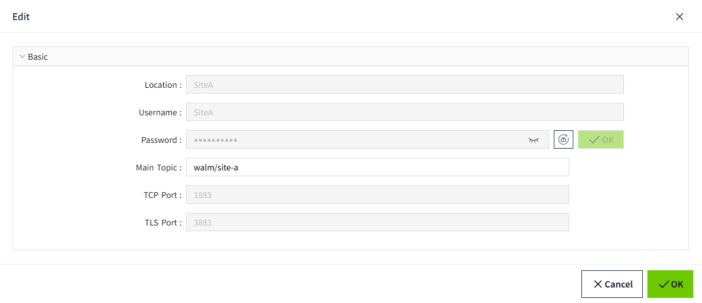
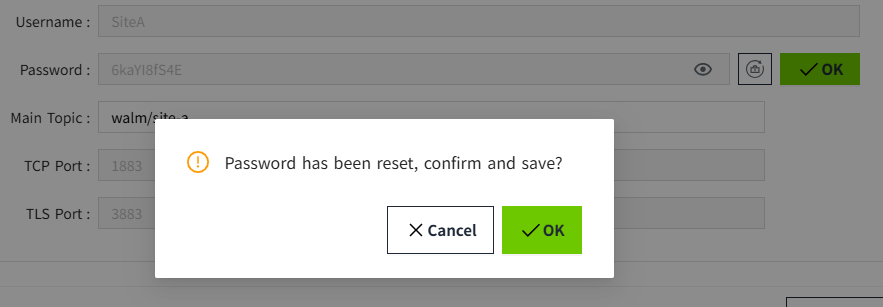
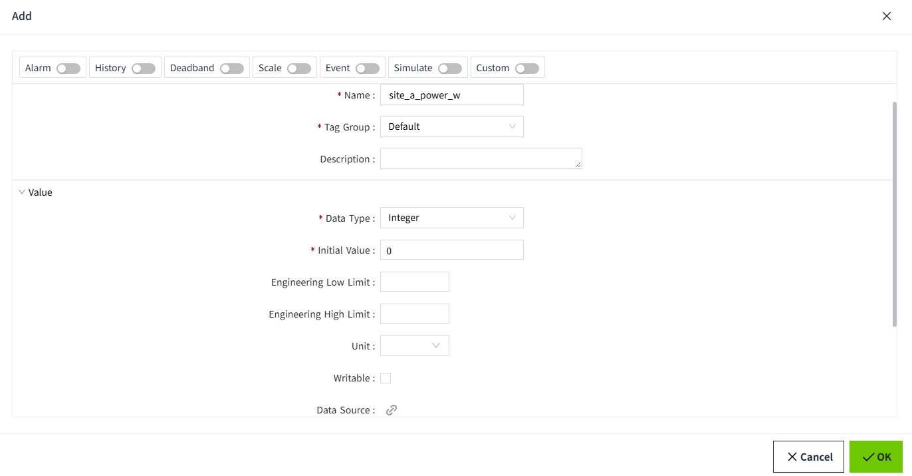
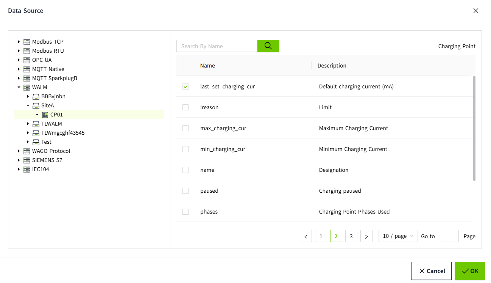
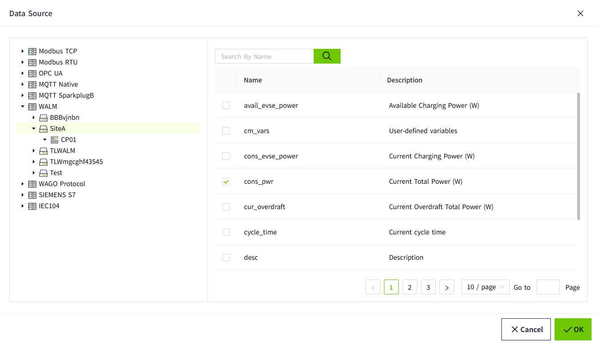

# WALM

The WALM driver connects WALM applications to the MQTT broker provided by VC Hub. It receives location information, electricity meter readings, and charging point data. Each location has its own connection username, password, and MQTT topic prefix.

WALM is available in the on-premise edition. The driver receives values published by the WALM application; writing values and sending control commands through this driver are not supported.

## Adding and Enabling a Location

A **Location** represents one WALM installation. A location contains its own **Device Info** tags and can contain multiple **Electricity Meter** and **Charging Point** devices.

1. Open **Devices → WALM** and click **Add Location**.
2. Enter a unique **Location** name, for example `SiteA`.
3. Enter the **Main Topic** used by the WALM application, for example `walm/site-a`. Leave it empty to use the location name as the topic prefix.

    

4. Click **OK**. The location is added in the disabled state. VC Hub generates its connection username and password.
5. Add the required devices as described below, then enable the location using its status switch before connecting the WALM application.

    

The status switch shows whether the location is enabled. It does not indicate whether the external WALM application is connected or publishing data. **Enable All** and **Disable All** apply to all configured WALM locations, including those on other pages.

### Adding Electricity Meters and Charging Points

1. Click **Add Device** in the location's row.
2. Enter the **Device Name** exactly as it appears in the device segment of the WALM application's MQTT topics, for example `CP01`.
3. Select **Electricity Meter** or **Charging Point** as the **Device Type**.
4. Click **OK**, then expand the location in the list to see its devices.

    

Device names must be unique within their location. The same name can be used in different locations. Devices use the location's connection credentials and enabled status; they do not have separate accounts or status switches.

### Configuration Fields

| Field | Description |
|---|---|
| Location | Unique location name, up to 100 characters. The name cannot be edited after creation. |
| Main Topic | MQTT topic prefix for the location. If empty, the location name is used. Use a distinct prefix for each location, matching the WALM application's configuration. |
| Device Name | Identifier used in the device segment of the MQTT topic, up to 100 characters. Names and tag identifiers must match the published topics exactly, including letter case. |
| Device Type | **Electricity Meter** for `meter` topics, or **Charging Point** for `evse` topics. |
| Username | System-provided MQTT connection username. Read-only; use the value displayed in the location details. |
| Password | System-generated MQTT connection password. It can be viewed and reset in the location details. |
| TCP Port / TLS Port | MQTT broker ports shown in the location details. Use a port whose listener is enabled in the broker settings. |

For multiple locations and devices, see [Batch Operation](batch-operation.md).

## Connecting to the MQTT Broker

1. Enable the required listener under **Node → MQTT Broker**. For TLS, configure the broker certificate before enabling the TLS listener. See <a href="../../mqtt-broker/">MQTT Broker</a>.
2. Click **View** in the WALM location's row. Obtain the **Username**, **Password**, and broker ports from the basic information section. Use the password visibility button to display the password when needed.

    

3. Configure the WALM application's MQTT connection:

    | Setting | Value |
    |---|---|
    | Broker address | Address of the VC Hub MQTT broker reachable from the WALM application. |
    | Broker port | Configured TCP or TLS port of an enabled broker listener. |
    | Client ID | A unique MQTT client identifier. |
    | Username / Password | Credentials displayed for this location in VC Hub. |
    | Topic prefix | The location's Main Topic, or its location name if Main Topic is empty. |
    | TLS | Enable when using the broker's TLS listener and configure the client to trust the broker certificate. |

4. Confirm that the location is enabled, then connect the WALM application and start publishing data.
5. Bind I/O tags to the required WALM tags to use the received values in VC Hub.

A disabled location's credentials cannot be used to connect. Disabling a location disconnects its client. After enabling it again, reconnect the WALM application if it does not reconnect automatically.

## Publishing Device Data

Each MQTT message carries the value of one tag. Use one of the following topic structures:

| Data category | Topic structure | Example |
|---|---|---|
| Location information | `{MainTopic}/device_info/{Tag}` | `walm/site-a/device_info/cons_pwr` |
| Electricity meter | `{MainTopic}/meter/{DeviceName}/{Tag}` | `walm/site-a/meter/Meter01/power_w` |
| Charging point | `{MainTopic}/evse/{DeviceName}/{Tag}` | `walm/site-a/evse/CP01/power_w` |

Replace the values in braces with the actual topic prefix, device name, and tag name. Location information has no device segment. For meter and charging point data, create the device under the location before publishing its values.

### Payload Structure

| Attribute | Type | Description |
|---|---|---|
| `val` | String | Value of the tag identified by the topic. |
| `tst` | Integer | Measurement time as a Unix timestamp in **seconds**, measured from 1970-01-01 00:00:00 UTC. |

For example, publish the following payload to `walm/site-a/evse/CP01/power_w`:

```json
{
    "val": "7200",
    "tst": 1700000000
}
```

This message reports a charging point power value of 7200 W. Use seconds for `tst`; millisecond timestamps are not supported by the WALM payload format.

The location account can publish to its own `device_info`, `meter`, and `evse` topics. The driver forwards a received value to I/O tags bound to that location, device, and tag. Messages for unconfigured devices or tags without a matching I/O binding do not update an I/O tag. Device and tag definitions are not created automatically from messages.

## Viewing Location and Device Tags

1. Click **View** for a location.
2. Select the location in the tree to display its **Device Info** tags.
3. Expand the location and select a device to display its **Electricity Meter** or **Charging Point** tags.
4. Use the table pagination to browse the tags. Click **Refresh** to reload the configuration.

    

The table lists the predefined tags for the selected category. It does not display live values or confirm that a tag has been reported by the WALM application.

| Category | Examples of available tags |
|---|---|
| Device Info | `cons_pwr`, `cons_evse_power`, `avail_evse_power`, `lb_enabled`, `lm_error`, `max_evses`, `real_evses`, `version` |
| Electricity Meter | `voltage_l1`, `voltage_l2`, `voltage_l3`, `current_l1`, `current_l2`, `current_l3`, `power_w`, `import`, `export`, `last_error` |
| Charging Point | `charging_enabled`, `max_charging_cur`, `min_charging_cur`, `rfid`, `paused`, `state`, `current_l1`, `current_l2`, `current_l3`, `power_w`, `total_energy` |

Use the tag descriptions and the WALM application's data definitions to determine the value type and unit. For example, the predefined phase-current descriptions use mA, and `power_w` uses W.

## Editing a Location

Click **Edit** for a location to change its **Main Topic** or reset its password. Location and Username are read-only.

To change the topic prefix, enter the new **Main Topic** and click **OK**. Update the WALM application's topic prefix to match, then reconnect it. Changing the topic prefix does not rename the location or its devices.



### Resetting the Password

1. Open **Edit** for the location.
2. Click **Reset** beside Password to generate a new password.
3. Record the generated password, then click **OK** beside the password field and confirm the change. You can also save the entire edit window using its bottom **OK** button.
4. Update the password in the WALM application's MQTT settings and reconnect it. The old password stops working after the new password is saved.

Clicking **Reset** only generates a candidate password. The current password stays active until you save and confirm the change. Saving a new password disconnects the existing client connection.



## Binding an I/O Tag

1. Create an **I/O Tag** in the asset editor. Choose a data type appropriate for the WALM value, such as a numeric type for `power_w` or String for a description.

    

2. Click the binding button beside **Data Source** and expand **WALM**.
3. Select the required source:
    - For location information, select the location itself.
    - For electricity meter or charging point data, expand the location and select the device.
4. Select a tag in the table on the right. Use **Search by Name** to filter the list.

    

5. Click **OK** to save the binding, then save the I/O tag.

For a location-level binding, select a **Device Info** tag such as `cons_pwr` directly under the location:



The binding records **Location**, **DeviceName** when applicable, **TopicType**, and **Tag**. Select the correct device and category when different sources have the same tag name. WALM bindings are read-only; marking an I/O tag as writable does not enable WALM write-back.

For general tag configuration, see <a href="../../assets-and-tags/tag/creating-tags/io-tag-binding-data-source/">I/O Tag Binding Data Source</a>.

## Managing Locations and Devices

- Enter a location name in the search box to filter the location list. The list supports pagination and sorting by name, enabled status, and creation time.
- Expand a location to view its devices. The inner list can be sorted by device name or creation time.
- Use **More → Export** to export one location, or **Export** above the list to export all locations. See [Batch Operation](batch-operation.md).
- Disable a location before deleting it. **More → Delete** removes the location and all its devices. For a single device, use **Delete** in the expanded device list. Check any affected I/O bindings after deletion.
- Use **More → View Logs** to open the device logs for the location.

## Troubleshooting

| Symptom | What to check |
|---|---|
| The WALM application cannot connect | Confirm that the location and the required broker listener are enabled, the address and port are reachable, and the application uses the location's current credentials. For TLS, check certificate trust. |
| Connected, but an I/O tag does not update | Check the Main Topic, `device_info`/`meter`/`evse` segment, configured device name, tag name, and I/O binding. Names must match exactly. Confirm that the payload contains `val` and `tst`, and that `tst` uses seconds. |
| Tags are visible, but no measurements arrive | The tag table displays predefined entries. Verify that the WALM application is publishing the corresponding topics and that the required I/O tags are bound. |
| Connection fails after editing or import | Re-enable the location if it was disabled by import, and update the WALM application's password or topic prefix if changed. |
| A write operation fails | WALM supports incoming data only. Writing values and sending control commands are not supported. |
