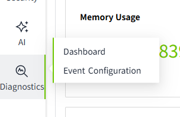
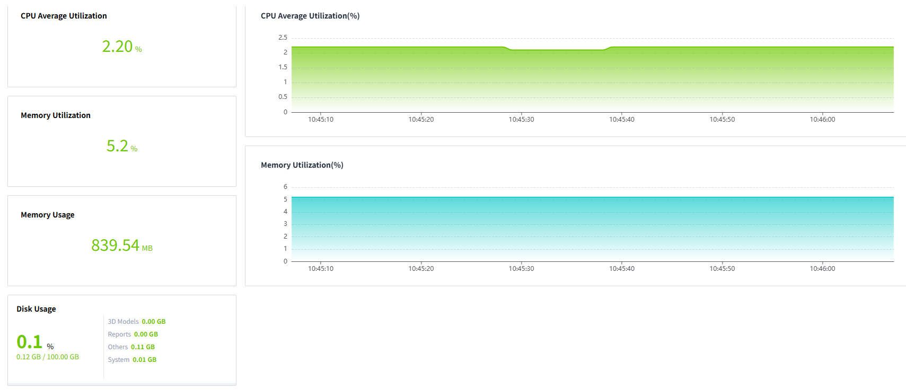
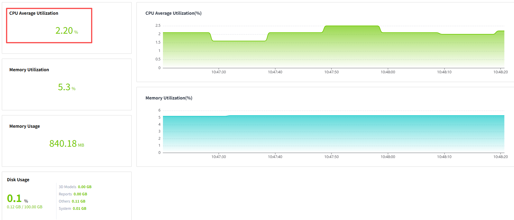
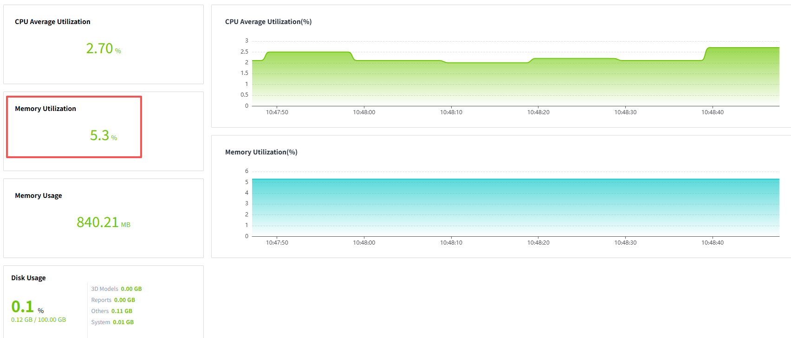
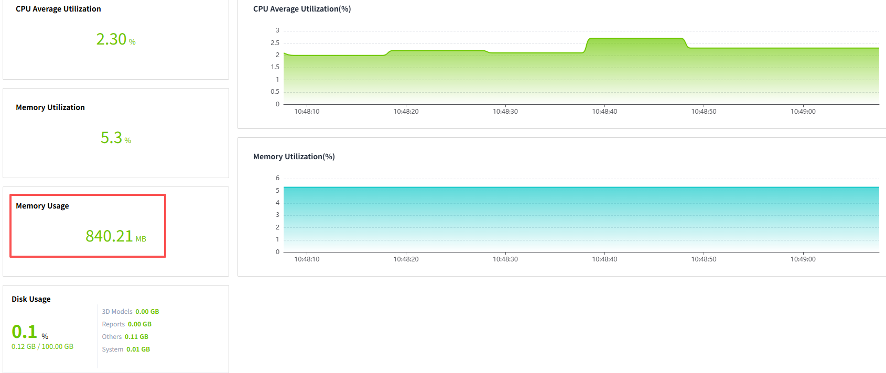
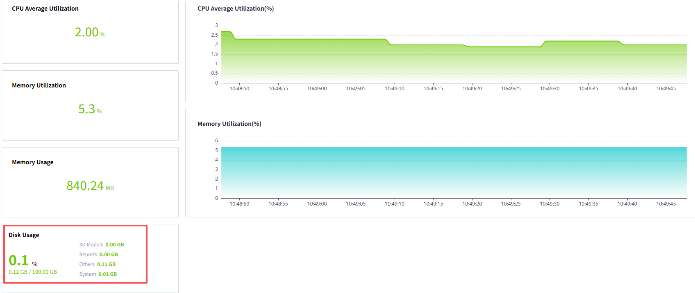
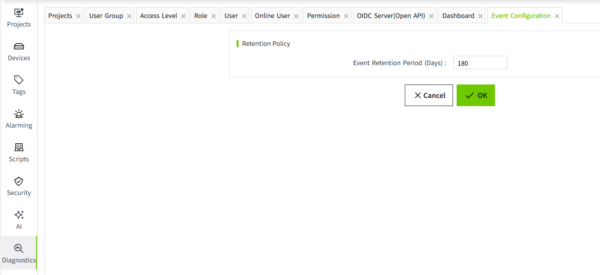

# Diagnostics

Diagnostic module is usually a tool for operation and maintenance personnel to carry out system diagnosis and troubleshooting, and is mainly used to query server status and other information.

You can view related log data under the "Diagnostics" menu.

## **Dashboard**

The dashbaord is used to monitor and display the key indicators and data in real time to help users better understand the system operation and find and solve possible problems in time.

Indicators to be monitored:

- CPU Average Utilization
- Memory Utilization
- Memory Usage
- Disk Usage

#### **CPU Average Utilization**

View the current CPU average utilization status through numerical values and line graphs. When the CPU average utilization exceeds 100%, it does not mean that the CPU is overloaded, but it is related to the number of cores of the CPU, for example, if the server CPU has 8 cores, then the percentage base of CPU utilization is 800%.

#### **Memory Utilization**

View the current server memory utilization percentage by value and line graph.

#### **Memory Usage**

With the specific memory usage values in the graph, you can clearly see how many MB of server memory is currently being used.

#### **Disk Usage**

Displays the overall disk space usage and the usage of each category.

## **Event Configuration**

Used to configure the storage policy of tag events. The events recorded here can be displayed on the "Real-time Events" and "Historical Events" controls.

The default event expiration date is 180 days, and the system will clean up the stale data regularly according to the set expiration date. 

