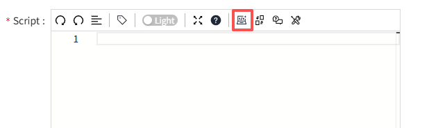
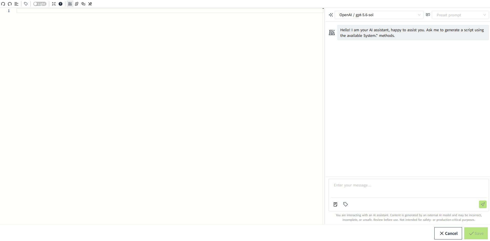
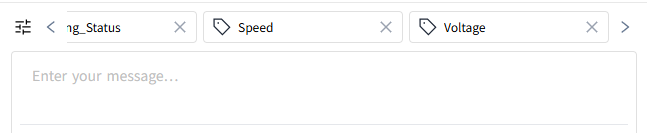
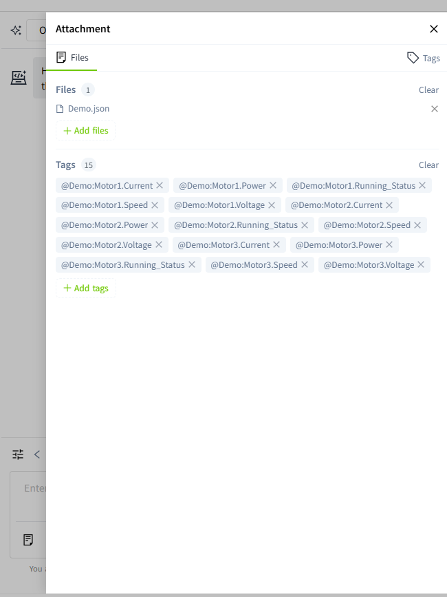
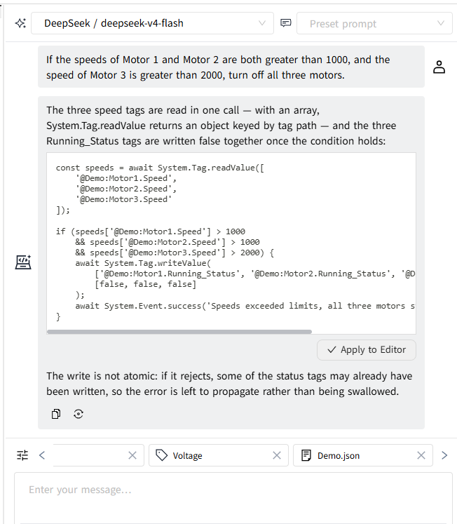
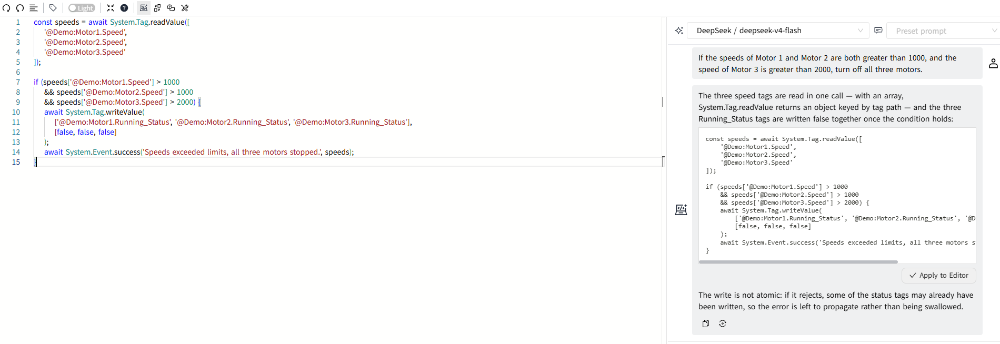
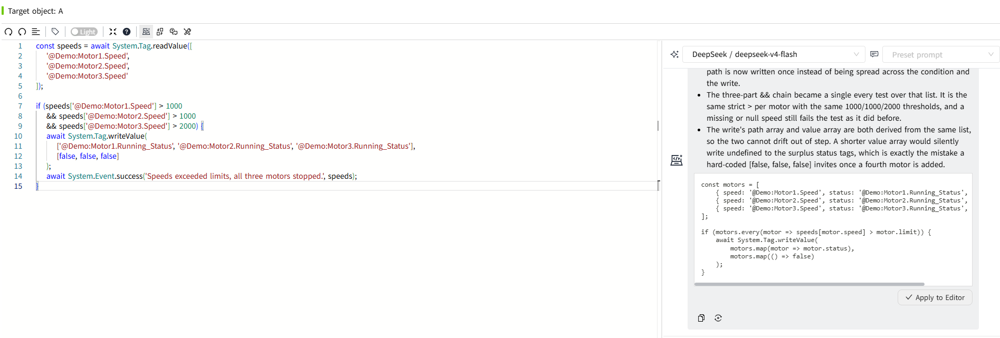
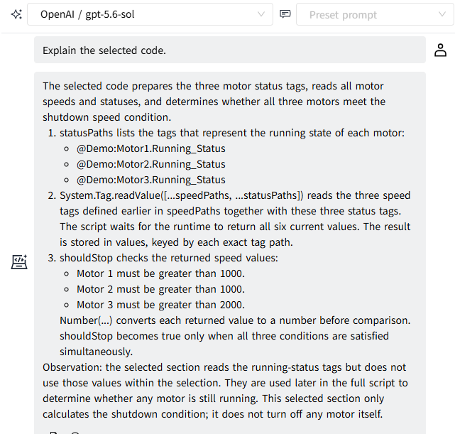
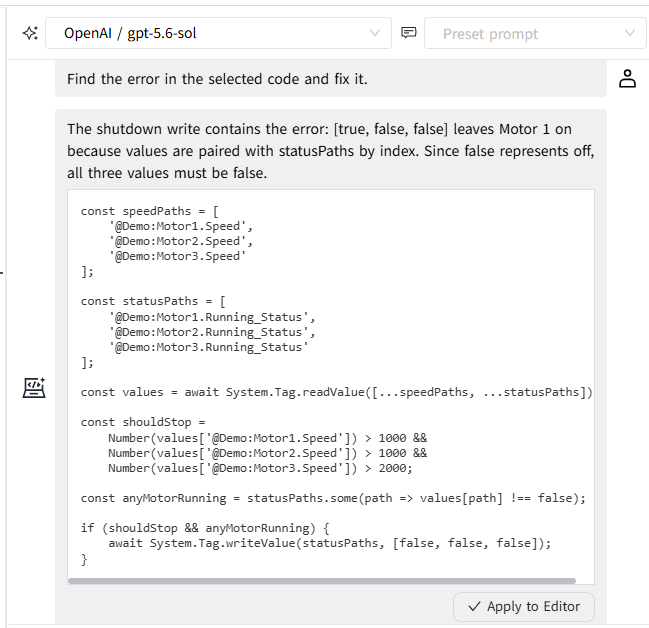

# Using the AI Assistant

The AI Assistant in the Script Editor helps you generate scripts based on natural language instructions. You can also provide additional context, such as tags, SQL Queries, and documents, to help the AI Assistant understand your requirements.

In the Script Editor toolbar, click AI Assistant to expand the editor to full screen. The AI Assistant panel is displayed on the right side of the page, while the script editing area remains on the left.

## Interface Overview

The Script Editor consists of two areas: the script editing area on the left and the AI Assistant area on the right.

At the bottom of the AI Assistant area, the message input field allows you to enter instructions and add contextual information. The selected context items are displayed above the input field. Use the arrow buttons to browse the items, or click the context overview button to view all added items.

| **Button**   | **Description**  |
|------------|---------------|
|        |  Upload files or add text and document content to provide additional context for the AI Assistant. |
|     | Select tags from the current system. The selected tags can be referenced in the generated content.|
|   | Send the message and the associated context to the AI Assistant to generate a script.  |

The added context items are displayed above the message input field. Use the left and right arrow buttons to browse the items. Click the button on the far left  to view all added context items.

Clicking the button on the far left  opens a panel on the right, displaying all added context items.

After adding the required context, enter a natural language description of the functionality you want to implement in the message input field. Click the Send button to submit your request. The AI Assistant generates the script in the conversation area.

!!! Note

    AI-generated content may be inaccurate, incomplete, or unsafe. Review the generated content carefully before using it.

The AI Assistant provides several actions to help you understand, improve, and correct existing code. Select the relevant code in the Script Editor, then choose the appropriate action.

## Generate Scripts

**Example: Automatic Motor Shutdown Based on Speed Thresholds**

**Scenario:** Generate a script that automatically turns off Motor 1, Motor 2, and Motor 3 when the speeds of Motor 1 and Motor 2 both exceed 1000 and the speed of Motor 3 exceeds 2000.

**Step 1:** Select tags

- Demo:Motor1.Running_Status
- Demo:Motor1.Speed
- Demo:Motor2.Running_Status
- Demo:Motor2.Speed
- Demo:Motor3.Running_Status
- Demo:Motor3.Speed

**Step 2:** Enter the prompt

If the speeds of Motor 1 and Motor 2 are both greater than 1000, and the speed of Motor 3 is greater than 2000, turn off all three motors.

**Step 3:** Click the "Send" button.

**Step 4:** The AI Assistant automatically generates scripts based on your prompt.

**Step 5:** Review the generated code. If it meets your requirements, click Apply to Editor to insert the HTML code into the editor on the left.

**Step 6:** Save the content.

## Refactor Selection

Refactor Selection improves the structure and readability of the selected code while preserving its intended functionality.

You can select a specific portion of the code to refactor or refactor the entire script.

After you trigger the refactoring action, the AI Assistant generates the refactored code in the panel on the right. Review the generated code and click Apply to Editor to insert it into the editor on the left.

## Explain Selection

Explain Selection helps you understand the purpose and execution logic of the selected code.

You can select a specific portion of the code to explain or explain the entire script.

The AI Assistant displays an explanation of the selected code in the panel on the right.

## Fix Selection

Fix Selection identifies and corrects syntax errors or logical issues in the selected code.

You can select a specific portion of the code to fix or fix the entire script.

After you trigger the fixing action, the AI Assistant generates the corrected code in the panel on the right. Review the generated code and click Apply to Editor to insert it into the editor on the left.

!!! Note

    - Previous conversation history is not retained when you close and reopen the editor.
    - Always review AI-generated code before applying or executing it.
