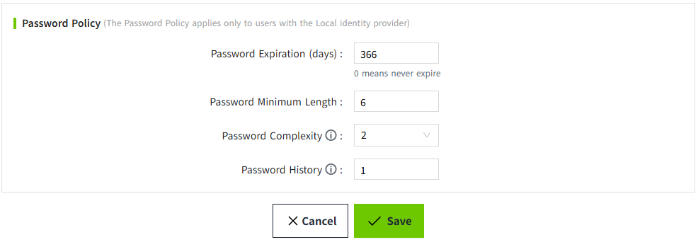

# Password Policy

The Password Policy settings allow administrators to configure password requirements to improve account security.

The following policies can be configured:

| **Setting**                       | **Description**               |
|----------------------------------|-------------------------------|
| Password Expiration                  | Specifies the validity period of a password. Users must change their passwords when they expire. 0 means never expire. |
| Minimum Password Length            | Specifies the minimum number of characters required for a password. |
| Password Complexity           | Number of required character types: lowercase, uppercase, digits, and special characters. |
| Password History       | Specifies the number of previous passwords that cannot be reused when changing a password. Set to 0 to disable. |

After configuring the password policy, save the settings to apply the changes.

**Password policies are enforced as follows**
    
- During login: VC Hub checks whether the password has expired. If the password has expired, the user must change it.

- During password change: VC Hub validates the new password against the minimum length, complexity, and password history requirements.
    