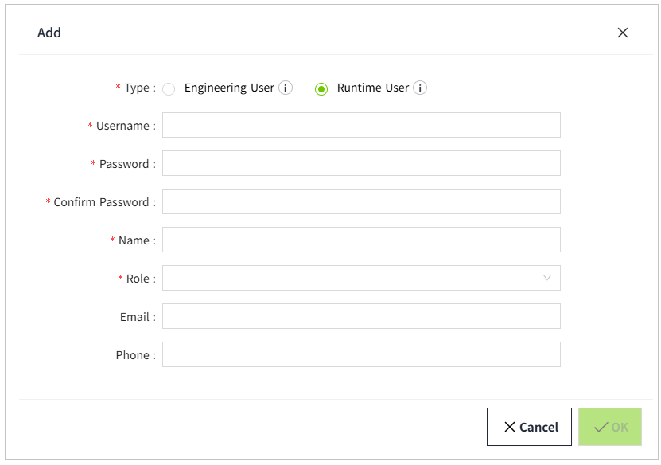

# Roles and Users

VC Hub provides 3 built-in roles.

- **Admin:** Has all privileges.  
- **Configurator:** The difference from the Admin role is that it does not have permission to access Security settings.
- **Operator:** Can only view the running page of the project.

**Notes:**

1. The built-in roles cannot be deleted.
2. When editing a built-in role, only the "Startup Page" and "Description" can be modified.

## **Creating Roles**

You can add other roles in the Roles page.

1. Click ”Security” > ”Role” in the menu.
2. Click the Add button on the Role list page to create a role.

**Configurations:**

| **Name**     | **Description**   |
|--------------|-------------------|
| Role Name    | The name of this role. |
| Description  | The description of this role.|
| Startup Page | You can configure a startup page for a role when the role can only view the running page of a specific project. Select a page from all project pages as the startup page. |

## **Creating Users**

When you log in for the first time, the first user created during installation is displayed in the user list. You can add other users on the users list page.

1. Click "Security"> "User".
2. Click the Add button on the user list page to create a user.  Only one role can be set for a user. 

**Type:**

Two user types are available: **Engineering User** and **Runtime User**.

| User Type | Description |
|-----------|-------------|
| Engineering User | Has the permission to perform system configuration and design pages. |
| Runtime User | It is limited to accessing and operating the project's runtime pages. |

