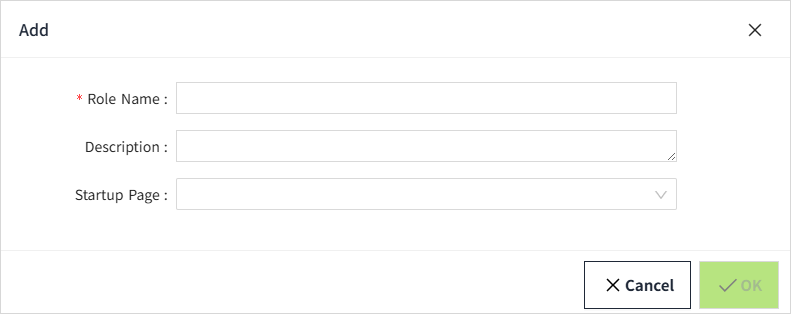
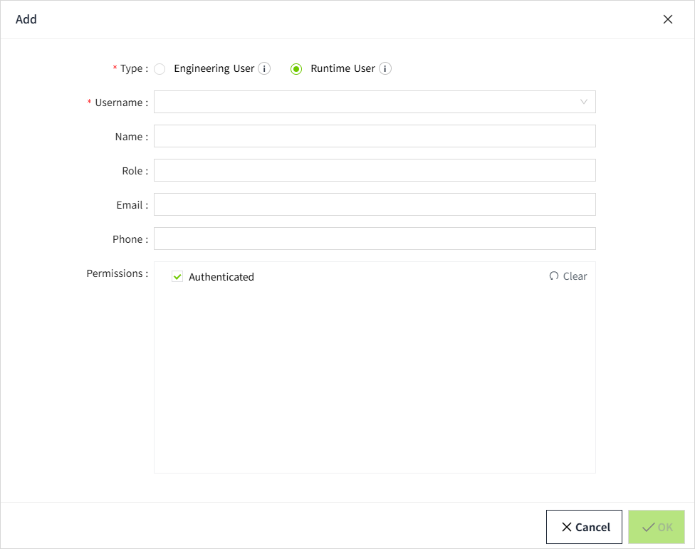

# Roles and Users

VC Hub provides 3 built-in roles.

- **Administrator:** Has all privileges.  
- **Editor:** The difference from the Administrator role is that it does not have permission to access Security settings.
- **Viewer:** Can only view the running page of the project.

**Notes:**

1. The built-in roles cannot be deleted.
2. When editing a built-in role, only the "Startup Page" and "Description" can be modified.

## **Creating Roles**

If a new role is created in WAGO Solutions Platform, a role with the same name must also be created in VC Hub. This ensures that the user's role can be matched correctly when accessing VC Hub from Solutions Platform.

You can add other roles in the Roles page.

1. Click ”Security” > ”Role” in the menu.
2. Click the Add button on the Role list page to create a role.

**Configurations:**

| **Name**     | **Description**   |
|--------------|-------------------|
| Role Name    | The name of this role. |
| Description  | The description of this role.|
| Startup Page | You can configure a startup page for a role when the role can only view the running page of a specific project. Select a page from all project pages as the startup page. |

## **Creating Users**

When a user accesses VC Hub from Solutions Platform, their information is automatically added to the User list in VC Hub.

If you want to assign permissions to a user in advance, you can create the user in VC Hub and configure their permissions beforehand. The next time the user accesses VC Hub from Solutions Platform, the available pages and operations will be based on the permissions configured in VC Hub.

1. Click "Security"> "User".
2. Click the Add button on the user list page to create a user.  

**Type**

Two user types are available: **Engineering User** and **Runtime User**.

| User Type | Description |
|-----------|-------------|
| Engineering User | Has the permission to perform system configuration and design pages. |
| Runtime User | It is limited to accessing and operating the project's runtime pages. |

**Username**

Use a dropdown list to select a user who has already been created in the company that the current user belongs to in Solutions Platform.

**Role**

Sets the user's role. When the user accesses VC Hub, the role information from Solutions Platform is automatically synchronized to VC Hub.

**Email，Phone**

Sets the user's email address and phone number.

When the user accesses VC Hub, the email address from Solutions Platform is automatically synchronized to VC Hub.

If the user wants to use SMS notifications for alarms in Solutions Platform, a valid phone number must be entered here.

**Permission**

Sets the user's permissions. Permissions determine which pages the user can access in VC Hub.

