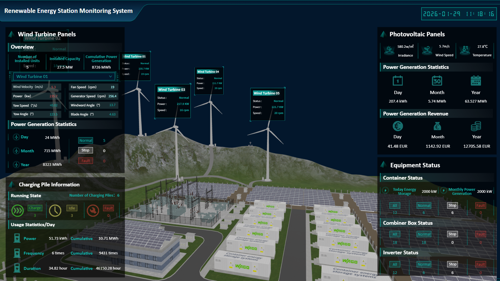
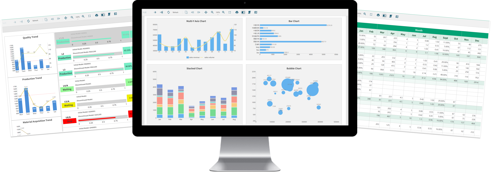
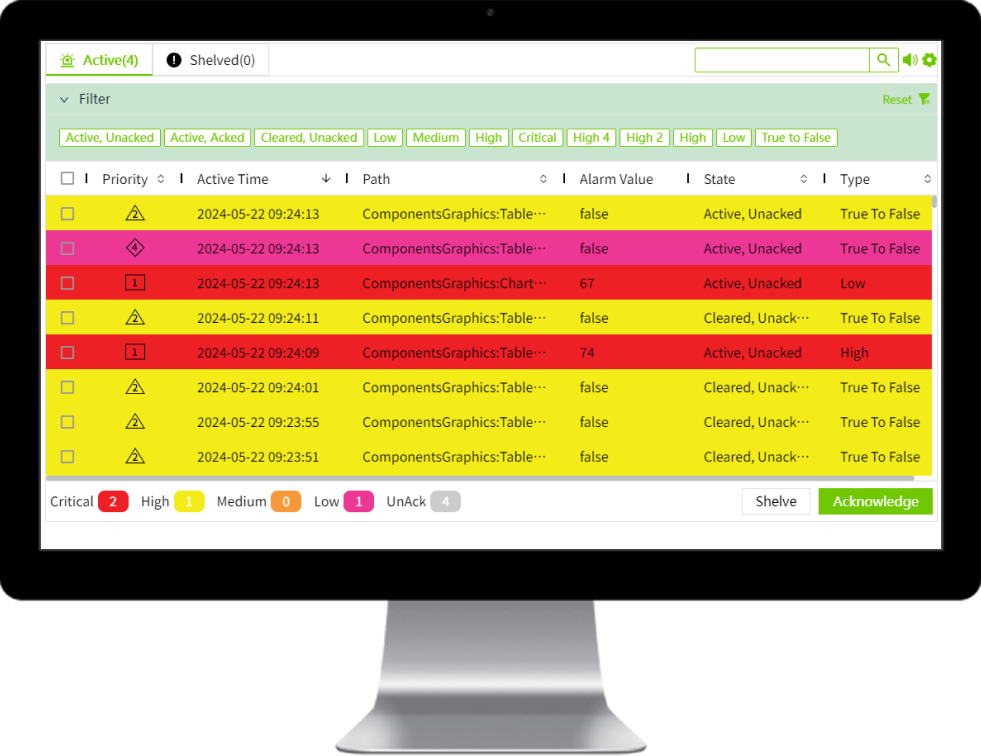

# Product Overview

**What is WAGO Visualization and Control Hub?**

 WAGO Visualization and Control Hub ("VC Hub" for short) is a SCADA product developed and marketed by WAGO. It is fully based on modern web technology, which allows you to easily use VC Hub to quickly build various complex field configuration applications. Whether on-premises or in the cloud, VC Hub enables you to monitor and control the entire industrial process in real-time from any location, ensuring continuity in production and enhancing efficiency. VC Hub also supports large-scale field configuration projects, allowing you to collect a vast amount of industrial data and gain in-depth insights through the built-in reporting tools, which helps further optimize production decisions. With no restrictions on the number of users and device connections, VC Hub is an economical choice suitable for industrial configuration projects of all sizes.

 VC Hub is committed to providing efficient and convenient solutions for your industrial configuration field.

**Features of VC Hub**

-  WYSIWYG (What You See Is What You Get): VC Hub provides a WYSIWYG configuration editor, providing real-time feedback during the configuration process, allowing users to view and test their design at any time during the configuration process.
-  Object-Oriented Modeling: VC Hub allows you to build monitoring points based on the physical model of the industrial field, managing your device data entirely in an object-oriented manner.
-  High Availability: VC Hub leverages the high availability capabilities of the underlying cloud platform to ensure reliable service operation and minimize service interruptions. 
-  High Security: VC Hub leverages the security capabilities of the underlying cloud platform to enhance system protection and help safeguard applications and data against unauthorized access.
-  Mobile Support: VC Hub supports mobile devices, allowing you to easily access and control functions anytime, anywhere through smart phones and tablets, for more real-time management of your industrial field.
-  3D Low-code Digital Twin Platform: VC Hub is low-code digital twin platform combines powerful digital modeling and low-code development capabilities, allowing users to easily create digital twin scenarios, simulate industrial processes, and rapidly develop 3D twin applications, providing faster innovation and responsiveness for industrial automation.

**Web-based Implementation**

 VC Hub is fully implemented based on web standards, so you can directly run and operate your VC Hub application using a web browser. For example, you can connect and configure PLC or historical storage directly through a web browser, and you can also use a web browser to configure your VC Hub application. Another benefit of being based on web standards is that it can make your configuration screen easier to create and more aesthetically pleasing than traditional desktops.

**High Performance**

 Profit from VC Hub is modern design architecture and built-in high-performance engine, it can monitor tens of thousands or even millions of field data points in real-time and perform storage and analysis.

**Reporting**

 VC Hub has a built-in online report designer, allowing you to complete report design through drag-and-drop. Report data can be seamlessly integrated with the VC Hub historical database and the company's SQL databases. It comes with a rich set of report controls, helping users easily design various report styles and export to multiple mainstream file formats, including Excel, Word, PDF, HTML, images, and JSON.

**Alarm**   

 VC Hub has built-in standardized alarm tools that you can use at any time to build your on-site alarm application. All alarms can be displayed and stored in real-time, and you can also confirm and suspend alarms at any time.

