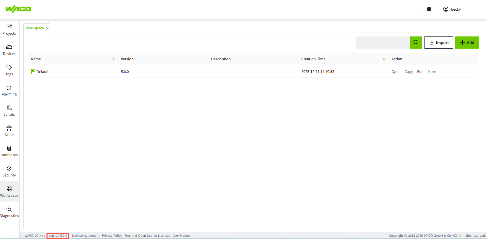
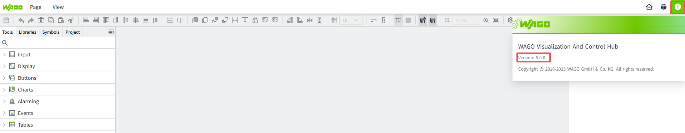

# Version Update Notes

 VC Hub is constantly evolving and being updated, with each new version bringing new features and bug fixes. Here, you can quickly preview the new features and resolved issues of the corresponding versions.

## Determining Your Current Version

 You can find out the version number of VC Hub you are currently using in the following two ways:

1.  In the bottom right corner of the management platform, you can find the corresponding VC Hub version number.
    
2.  In the top right corner of the configuration editing interface, you can click on this icon to get the corresponding VC Hub version number information.
    

## New Features

#### 5.2.X

- **AI Assistant:** VC Hub introduces an AI Assistant to simplify script development and visualization design. In the Script Editor, users can generate scripts by describing their requirements in natural language and providing relevant variable information. In the HTML Viewer control, the AI Assistant helps users quickly generate visually appealing runtime pages, making it easier to create customized interfaces with less manual effort.
- **German Language Support:** VC Hub now supports German in addition to the existing system languages, providing a more localized user experience and better accommodating the language preferences of users in German-speaking regions.
- **Enhance WAGO Protocol Compatibility:** VC Hub enhances WAGO Protocol compatibility by supporting hierarchical collections, custom commands, built-in WAGO Protocol commands, and communication with a handshake mechanism.
- **Integrate with the Solutions Platform:** VC Hub can now be integrated into the WAGO Solutions Platform, enabling cloud-based deployment and centralized platform management. The integration supports tenant-aware application lifecycle management, identity and access configuration, and secure access within a multi-tenant environment, providing a foundation for delivering VC Hub as a SaaS solution.
- **Workspace File Signing and Verification:** VC Hub supports signing and verifying workspace files to help ensure their authenticity and integrity. When importing a workspace, the system verifies its signature to detect unauthorized modifications or replacement. This mechanism supports secure workspace exchange both within the same system and across different system instances.
- **SMS Abuse Prevention:** VC Hub improves SMS notification security by helping prevent SMS abuse and excessive usage. This helps reduce unexpected SMS costs, prevent SMS quota exhaustion caused by excessive alarm notifications, and ensure the reliable delivery of critical alarm messages.
- **File Upload Size Limit:** VC Hub introduces file size limits for upload operations to prevent excessively large files from being uploaded, helping manage resource consumption and improve system stability.
- **Complete Data Removal During Uninstallation:** VC Hub improves the uninstallation process by providing an option to remove the application’s data folder, including configuration files, cached data, logs, and downloaded assets. This helps users free up disk space, avoid configuration conflicts during reinstallation, and remove residual data when required.
- **Login Attempt Delay:** VC Hub introduces a delay mechanism after repeated failed login attempts to help prevent brute-force attacks and enhance account security.
- **Password Policy Enhancement:** VC Hub introduces configurable password policies to strengthen password security and improve account protection.
- **Upgrade AR Report to Version 20:** VC Hub upgrades AR Report to version 20 to improve compatibility and maintain the reporting component.
- **Associate System Logs with Devices:** VC Hub enhances system logging by associating system logs with the corresponding devices, making it easier to identify device-related events and troubleshoot issues.
- **Decouple Tags from the 2D Designer:** VC Hub decouples tag management from the 2D Designer, allowing tags to be managed independently of the 2D design environment.
- **EMS License Management:** VC Hub now supports EMS license management, allowing users to activate EMS licenses directly in VC Hub.
- **WALM Support:** VC Hub now supports WALM as an additional drive type, expanding the range of supported drive types for EMS applications.
- **Login Attempt Delay:** VC Hub introduces a delay after repeated failed login attempts to help prevent brute-force attacks and enhance account security.

#### 5.1.X

- **Separate licensing for runtime and engineering users:** When a user logs in, distinguish whether they are an engineering user or a runtime  user. If the user is an engineering user, redirect them to the Admin Console page after login; if the user is a runtime user, display the runtime page.
- **IEC 60870-5-104:** Added support for the IEC 60870-5-104 (IEC 104) protocol.
- **Add New License Types:** The License Items have been expanded to include 100,000 I/O tags, 20 concurrent online users, 50 concurrent online users, and IEC 104 support.
- **Concurrent Online Users Include Engineering Users and Runtime Users:** The original “concurrent online users” refers to engineering users. Based on this, concurrent online user limits for runtime users have now been added.
- **OPEN APIs Enhancement:** Introduced batch and CRUD (create, read, update, delete) APIs for assets, models, instances, tags, and alarm configurations, improved error messages, and provided full lifecycle management APIs for Modbus TCP devices and frames, including control, monitoring, and querying capabilities.
- **Upgrade Angular to v21.x:** Upgrade the Angular version to the latest official release.(Angular is a front-end web application development framework.)
- **Add "Page Container" and "IFrame" to the navigation method of the Menu:** When using the Menu control for page navigation, support has been added for navigation within the "Page Container" and "IFrame" controls.
- **Labeling:** If customers have labeling requirements, they can provide assets such as product name, abbreviation, logo, login/logout page images, theme color, and browser icon. We will use these assets to generate a dedicated installation package for the customer.
- **Reset User Password:** Provide password recovery capability for users, allowing password reset through the login page “Forgot Password” function or via the Command Tool bundled in the installation package.
- **Support importing projects across minor versions**: Projects can be imported from an earlier minor version into a later minor version, such as from 5.0.x to 5.1.x. Previously, only projects from the previous patch version, such as 5.0.1 to 5.0.2, were supported.

#### 5.0.X

- **License Management**: Support license activation, deactivation, refresh, update and deletion.
- **Force logout online user**: If the number of concurrent users reaches the license limit, the system will automatically force the earliest logged-in user to log out when a user with security permission logs in. Ensure that users with security permission can always access the system, or release the login slots for other users to use.

#### 4.5.X

- **License Management**: Activate the license using DRM. This version only supports the trial mode of the license.

#### 4.4.X

- **Logo and Name Modification**: The product logo has been replaced, and the product name has been changed from WAGO SCADA to WAGO Visualization and Control Hub, abbreviated as VC Hub.

#### 4.3.X

- **SVG Editor**: Through the SVG editor, users can modify and save attributes of SVG images in the library, such as color, size, text content, and visibility.
- **Toggle Button**: Switches between ON and OFF states when clicked. Commonly used to control Boolean-type devices, such as start/stop or on/off switches.
- **2-State Button**: Represents two distinct states, typically ON/OFF or Start/Stop. Each state can be configured with specific appearance styles.
- **Multi-State Button**: Contains multiple states and can switch between them. Each state can be configured with its own appearance style.
- **Historical Data Storage of Raw Values**: When storing historical data for variables, it is possible to store the original raw values of the tags.
- **Page Functions and Expression Functions**: By defining page functions or expression functions, common logic can be centralized and reused. This avoids writing the same logic repeatedly in each component, allowing one modification to take effect globally, reducing maintenance costs.
- **Binding Support for Enabling/Disabling Animations**: When configuring animations for components, the enabling and disabling of animations can be controlled through property bindings.

#### 4.2.X

- **Permissions**：Supports single sign-on; allows setting permissions for projects and pages.
- **SQL Query**：Enables querying data from third-party databases. It is a pre-configured query that can be later bound to controls. When executing SQL statements, parameters can be passed to return dynamic result sets.
- **Table Control**: Displays data in a table format. You can customize the table’s content, style, and interactive effects.
- **Bidirectional Binding**：Tags, indirect tags, and properties support bidirectional binding. For example, if a control is bound to a tag, changes in the tag will be reflected in the control, and modifying the control’s value will also update the tag.
- **Parameterized Data Source Binding**：When binding a data source to a tag, parameters can be used to replace path content. Later, modifying the parameter value will automatically update the path.
- **Batch Editing Control Properties**：For the same type of controls, such as multiple labels, selecting all of them allows batch modification of their properties.
- **Editable System Tags**：System tags can be edited and configured for alarms, historical storage, and other settings.
- **OPC UA**：Add discovery service function.
- **Camera**: Configure WebRTC Streamer to set up the camera, enabling camera streaming while keeping it separate from the VC Hub server.
- **WeCom and DingTalk support to receive alarm notification**: Support to send alarm notification to WeCom group, WeCom account, DingTalk group, DingTalk account.

#### 4.1.X

- **Alarm Notifications**: VC Hub can send alarm notifications to specific users when a system alarm occurs. Notifications can be sent via email or SMS.
- **Symbols**: Symbols can be used to create detailed models of devices or systems, supporting combinations of multiple components and sub-symbols. This allows users to easily monitor the overall system operation. VC Hub supports user-defined symbols, enhancing operational efficiency.
- **Workspace Upgrades**: VC Hub supports upgrading historical workspaces to the version of the currently installed package.
- **Open API**: VC Hub allows data to be shared with external applications or partners via APIs for seamless data sharing.
- **Property Binding**: Added support for "Dynamic Tag" binding and "Cell Update" binding.
- **Batch Operation Tags**: VC Hub supports bulk addition and editing of tags through Excel.
